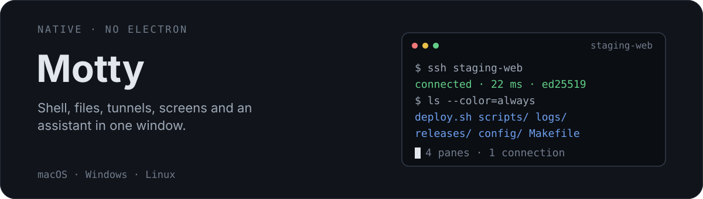
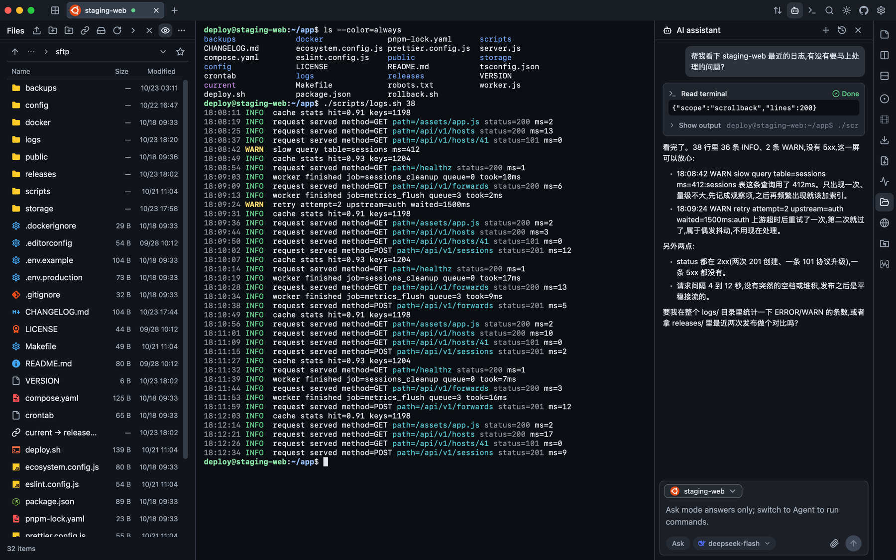
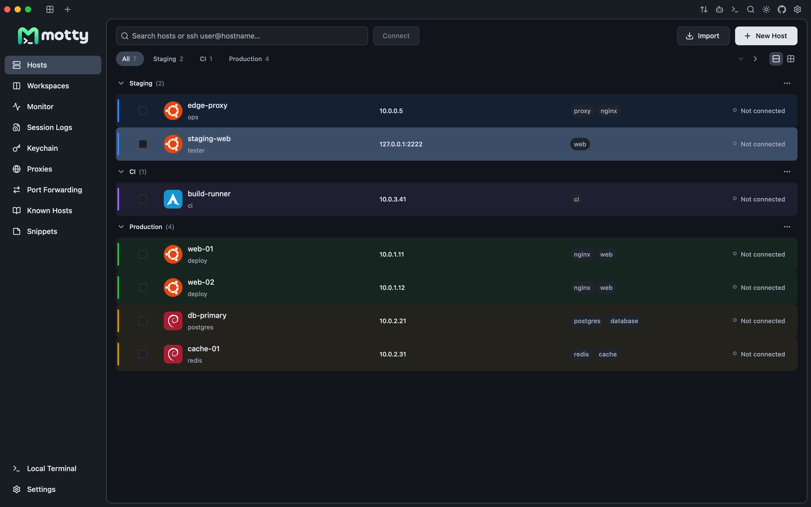
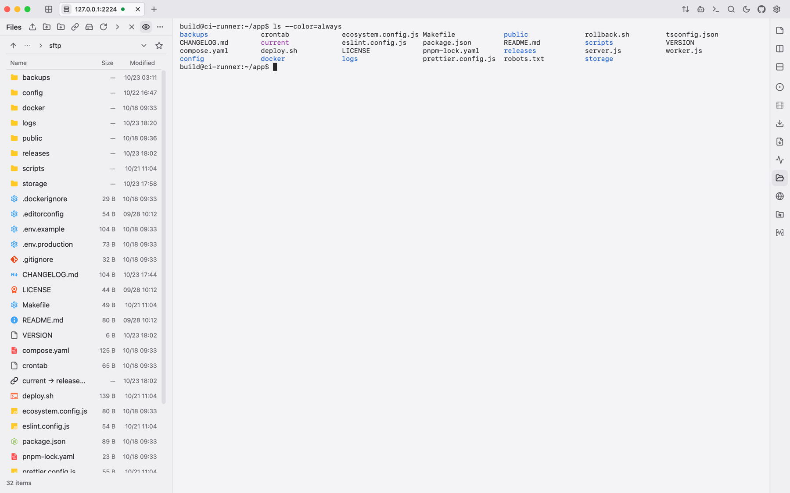
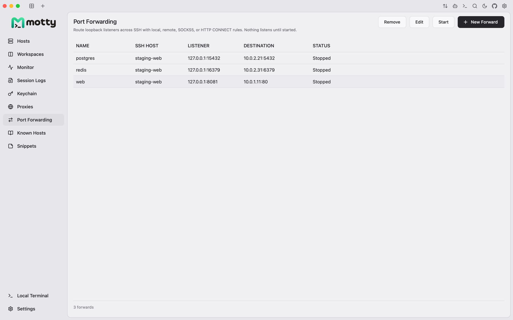
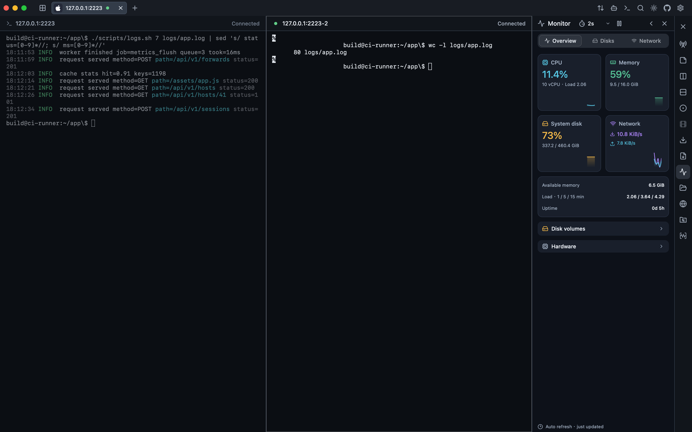
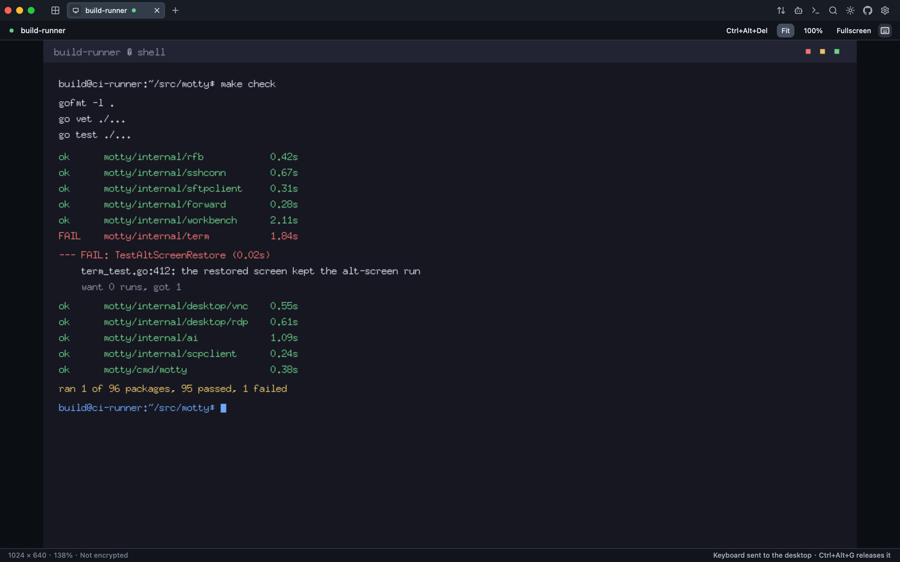
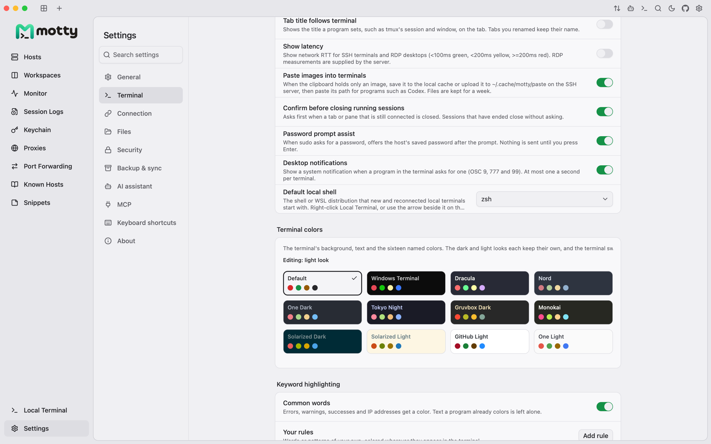

<div align="center">
  <p><a href="README.md">English</a> | <a href="README.zh-CN.md">简体中文</a> | 日本語</p>

  <p>
    <a href="assets/readme-hero.svg"></a>
  </p>

  <p>
    <a href="https://qm.qq.com/cgi-bin/qm/qr?k=&group_code=1131573299"></a>
    <a href="https://docs.qq.com/doc/DVXBGYnFFdm9UWkVP"></a>
    <a href="https://discord.gg/6s5tn9H4p2"></a>
    <a href="https://linux.do/t/topic/3086528/1"></a>
  </p>

  <p>
    <a href="assets/readme-hero.png"></a>
  </p>
  <p><sub>実際のセッション：ファイルパネル、デプロイログを追うシェル、同じターミナルを読むアシスタント。</sub></p>
</div>

Motty はデスクトップの SSH クライアントです。ターミナル、SFTP パネル、ポート
フォワーディング、リモートデスクトップ、AI アシスタントがひとつのウィンドウに
収まっているので、ファイルのために別のアプリを開く必要も、画面を見るために
ブラウザのタブを開く必要もありません。

ドキュメントは <https://motty.page/en/docs> にあります（サイトは英語と中国語のみ）。
このファイルではプロジェクトそのもの、パッケージ、ビルド方法を扱います。

<table>
  <tr>
    <td width="50%" valign="top">
      <a href="assets/readme-hosts.png"></a>
    </td>
    <td width="50%" valign="top">
      <a href="assets/readme-sftp-light.png"></a>
    </td>
  </tr>
  <tr>
    <td width="50%" valign="top">
      <a href="assets/readme-forward-light.png"></a>
    </td>
    <td width="50%" valign="top">
      <a href="assets/readme-monitor.png"></a>
    </td>
  </tr>
  <tr>
    <td width="50%" valign="top">
      <a href="assets/readme-desktop.png"></a>
    </td>
    <td width="50%" valign="top">
      <a href="assets/readme-settings-colors.png"></a>
    </td>
  </tr>
</table>

## なぜ Motty なのか？

<table>
  <tr>
    <td width="50%" valign="top">
      <p><strong>ホストが散らからない。</strong>グループ、タグ、色、アイコンを付けられ、
      OpenSSH config、PuTTY、MobaXterm など 7 種類の取り込み元から読み込めます。パスワードは
      AES-256-GCM の保管庫へ、鍵はシステムのシークレットストアへ。</p>
    </td>
    <td width="50%" valign="top">
      <p><strong>セッションが見える。</strong>ペインを分割すれば、CPU を使っている
      シェルの隣で、そのマシンの CPU、メモリ、ディスク、ネットワークをそのまま読めます。</p>
    </td>
  </tr>
  <tr>
    <td width="50%" valign="top">
      <p><strong>画面も要るときに。</strong>VNC と RDP の両方に接続でき、サーバーが
      自分のループバックでしか待ち受けていない場合は SSH ホスト経由で届きます。</p>
    </td>
    <td width="50%" valign="top">
      <p><strong>トンネルが見える。</strong>ローカル、リモート、SOCKS5、HTTP CONNECT の
      ルールはループバックにだけバインドし、保存して明示的に開始します。トンネルは
      所有する SSH タブと一緒に止まります。</p>
    </td>
  </tr>
</table>

**キーボードが主役。**タブ、分割、SFTP、フォワーディング、アシスタントはすべて
コマンドパレットのコマンドで、マウスは必須ではありません。**限界も正直に：**
[docs/remote-desktop.md](docs/remote-desktop.md) に VNC と RDP がまだできないことを
列挙し、リリースノートには実機で検証したプラットフォームを書いています。
**外へ何も送らない：**利用状況の収集はなく、更新確認は既定でオフで、有効にした
ときだけ GitHub Releases を参照します。

## インストール

お使いのプラットフォーム向けのパッケージを
[リリースページ](https://github.com/t8y2/motty/releases)からダウンロードしてください：

| プラットフォーム | パッケージ |
| --- | --- |
| macOS (arm64, amd64) | `.dmg`、`.zip` |
| Windows (amd64, arm64) | `.exe` インストーラー、ポータブル版 `.zip`（データは `motty.exe` の隣の `motty-data` に保存） |
| Linux (amd64, arm64) | `.deb`、`.tar.gz` |

macOS のビルドは、リリースに認証情報がある場合に署名と公証が行われます。
Windows のビルドは、証明書が設定されている場合に署名されます。Linux のパッケージは
署名されていません。AUR と `.AppImage` はまだ提供していません。

パッケージマネージャーを使う場合：

```sh
brew install --cask t8y2/tap/motty
```

Homebrew から先に tap を信頼するよう求められた場合は、一度だけ `brew trust t8y2/tap` を実行してください。

```powershell
scoop bucket add t8y2 https://github.com/t8y2/scoop-bucket
scoop install t8y2/motty
```

cask は公証済みのディスクイメージをインストールし、自己更新するものとしてマークされているため、
インストールしたコピーは自動的に更新されます。Scoop はポータブル版をインストールします：その
`motty-data` フォルダーはバージョンをまたいで保持され、更新には `scoop update motty` を
使います。

## クイックスタート

1. **Hosts** を開き、**New host** を選びます。
2. 名前、アドレス、アカウント名を入力します。
3. 認証方法を選びます：実行中のエージェント、秘密鍵のファイル、またはパスワード。
4. 接続し、ホスト鍵のフィンガープリントをサーバーのものと照合します。一度だけ信頼するか、
   保存します。
5. タブがログインシェルで開きます。ワンタイムコードを求めるサーバーでは、
   追加の欄が自動的に表示されます。

コマンドパレットは、macOS では **Command+Shift+P**、それ以外では **Control+Shift+P** です。
デフォルトのショートカットは、macOS では Command、Windows/Linux では Control を使います。
すべてのショートカットは変更できます。

Windows では、**Settings → Terminal → Local shell** のドロップダウン（**Inline suggestions** の下）で
ローカルシェルを選びます。Motty は、PATH と一般的なインストール先のフォルダーから、
PowerShell、CMD、Git Bash などのインストール済みのシェルを検出し、
インストール済みの WSL のディストリビューションをそれぞれ個別の項目として一覧表示します。ファイルパネルは、
ディストリビューションの `\\wsl.localhost` 共有を通じて、WSL のターミナルのフォルダーにも追従します。
PowerShell に `wsl` と入力するのではなく、ここでディストリビューションを選んでください：
フォルダーを報告できるのは、Motty 自身が起動したシェルだけです。この選択はこの
コンピューターに保存され、新しいローカルターミナルや再接続したローカルターミナルに適用されます。

| 操作 | macOS | Windows / Linux |
| --- | --- | --- |
| コマンドパレット | Command+Shift+P | Control+Shift+P |
| ターミナル内を検索 | Command+F | Control+F |
| コマンド履歴 | Command+Shift+H | Control+Shift+H |
| ファイルパネル | Command+Shift+S | Control+Shift+S |
| 新しいウィンドウ | Command+Shift+N | Control+Shift+N |

## 機能

### しっかりついてくるターミナル

本物の PTY セッション、256 色とトゥルーカラーの出力、代替スクリーン、5,000
行のスクロールバック、全角文字と結合文字、マウスレポート、入力
メソッド、PTY に追従するウィンドウのリサイズに対応しています。Synchronized updates（DECSET
2026）によって全画面の再描画をアトミックに保ち、kitty keyboard protocol によってキーの
押下、解放、曖昧さのない Escape/Alt キーを報告し、Windows のローカルシェルでは
win32-input-mode を使えます。フォントの合字は、固定幅のグリッドの中でシェーピングされます。
タブは並べ替え、水平または垂直の分割、ウィンドウ間の移動ができ、
再接続せずに復元できます。

**Settings > General > Tab orientation** で、水平のタブか、左サイドバーの垂直の
リストかを選べます。ターミナルのワークスペースでは、垂直のリストを展開したままにするか、
ターミナルのサイズを変えずにホバー時に展開されるアイコンレールに折りたたむかを選べます。
これらのレイアウトの設定は、このデバイスに保存されます。

**Group vertical tabs** は、General にある別の設定で、デフォルトではオフです。有効にすると、
同じ接続先に対する複数のタブが、折りたためるサーバーの見出しの下にまとめて表示されます。
接続が 1 つだけの場合は、単独のタブのままです。アカウント、プロトコル、ポート、ローカルシェルの環境が
異なるタブや、複数のサーバーにまたがる分割タブは、別々のままです。グループ化によって変わるのは
垂直のリストだけです。セッションが統合されたり切断されたりすることはなく、オフにするか水平モードに戻すと、
元の順序に戻ります。

ウィンドウとターミナルのツールバーのアイコンは、上部、左右どちらかの上側または下側のグループ、
下部バーのどちらかの端にドラッグできます。ドロップはマウスを離した時点で確定します。
Escape を押すか、ドックの外にドロップすると、レイアウトは変わりません。アイコンを右クリックすると、
移動や非表示、ツールバーのカスタマイズ、デフォルトのレイアウトへの復元ができます。
Settings > General でも、表示、順序、位置を設定できます。配置は
このデバイスに保存され、ターミナルの操作はアクティブな分割に従います。SFTP の
ツールバーは、表示と順序の設定を別に持っています。

Settings > General > Terminal toolbar > Customize では、左右のレールと下部バーについて、
移動したウィンドウの操作も含めて、小・中・大のサイズを選べます。
この選択はこのデバイスに保存されます。上部バーのアイコンは標準のサイズのままです。
接続の色はタブとホストのマーカーに残り、ターミナル、ファイル、
モニターのヘッダーにはニュートラルな背景が使われます。

保持された履歴の検索、HTTP/HTTPS と OSC 8 のリンクを開く、
Kitty/iTerm2/SIXEL の画像の表示、スニペットの送信、分割タブ全体への入力のブロードキャスト、
明示的なセッションの記録ができます。ターミナルには 11 種類の配色、キーワードの
ハイライト、オプションのインラインのコマンド候補があります。

### ホストと認証

ホスト鍵は、認証情報を送信する前に、Motty 独自の `known_hosts` と照合して検証されます。
認証には、エージェントの鍵、ID ファイル、OpenSSH のユーザー
証明書（鍵ファイルに対応する `-cert.pub` は、OpenSSH と同じ方法で
ペアとして読み込まれます）、PuTTY の `.ppk` ファイル（バージョン 2 と 3、Argon2id を含む）、
パスワード、キーボードインタラクティブのやり取りに対応しています。複数の質問をするやり取り
（たとえば、同じ PAM スタックからのパスワードとワンタイムコード）は、質問ごとに 1 つの欄を持つ
1 つのダイアログとして表示されます。証明書を提示するホストは、その CA が `@cert-authority` として
登録されていれば、確認なしで接続します。未知の証明書については、ほかの未知の鍵と同じように、
フィンガープリントを示して確認を求めます。
ホストごとに、ローカルの ssh-agent をそのシェルにフォワードすることもできます（ホスト単位で設定し、
デフォルトではオフです）。

ホストは、グループ化、タグ付け、検索ができ、OpenSSH の設定、PuTTY、
Xshell、MobaXterm、WindTerm、Electerm、Netcatty からインポートできます。TOTP/HOTP のシードは
保管庫に保存して、自動で入力できます。保存したパスワードと鍵のパスフレーズは、
AES-256-GCM の保管庫に、対応するホストの下に保存されます。保管庫の鍵は
システムのシークレットストアに保存され、それがない場合は保管庫の隣の鍵ファイルに保存されます
（ポータブル版でも同様です）。
Electerm と Netcatty からのインポートでは、明示的な同意のもとで、読み取り可能な SSH のパスワードを保存できます。
再インポート時には、不足しているパスワードだけが補われます。

### 別のアプリなしでファイルを扱う

複数選択、再帰的なアップロード/ダウンロード、上限付きの転送
キュー、再開、キャンセル/リトライ、名前の変更、削除、パーミッション、ブックマークに対応した SFTP のブラウジング。
ファイルを置き換えるときは、部分的なコピーをステージングし、再開したプレフィックスを検証し、
完全に同期されたコピーができてから初めてアトミックに名前を変更します。失敗した場合でも、
元のファイルはそのまま残ります。

ネイティブのエディターは、最大 1 MiB の UTF-8 のファイルを開き、ステージングの前後でリモートのファイルの
ハッシュを計算し、パーミッションを保持します。SFTP のないサーバーでは、
組み込みの SCP へのフォールバックを使えます。

パネルのその他のメニューから、表示中のフォルダーを、エディター独自の URL スキームを通じて
VS Code または Zed で開けます。エディターは **Settings > Files** で選択します。そこには
このコンピューターにインストールされているエディターが一覧表示され、選択するまではメニューの項目は
表示されません。サーバーは、SSH の設定でそのホスト自体（同じアドレス、ユーザー、ポート）に付けられた
エイリアスで、または `user@host` として開かれます。Motty だけが保持している踏み台ホストを経由して
接続するホストは、エディター自身の ssh がその踏み台を使わないため、拒否されます。

接続されたファイルパネルは、Bash と Zsh では、SSH のターミナルのフォルダーに自動的に追従できます。
**Settings > Files** には、準備ができた空のプロンプトで、ターミナルがファイルのナビゲーションに追従する、
デフォルトでオフの別のスイッチもあります。安全性と起動時の互換性の詳細については、
[フォルダーの同期](docs/terminal-folder-sync.md)をご覧ください。

### フォワーディングと踏み台のチェーン

ローカル、リモート、SOCKS5、HTTP CONNECT のルールは、ループバックのみで、永続化され、
明示的に開始します。トンネルは、それを所有する SSH のタブとともに停止します。踏み台のルートでは、
すべてのホップを個別に検証して認証します。グローバルな送信用の SOCKS5/HTTP
プロキシで最初の接続を行うこともできます。保存した各ネットワークホストは、それを継承するか、
直接接続を強制するか、独自の SOCKS5/HTTP プロキシを使うか、`cloudflared access ssh` のような
プロキシコマンド（OpenSSH の `ProxyCommand`）を通じて接続するかを選べます。X11
フォワーディングでは、セッションごとの偽の Cookie を検証してから、ローカルの
Xauthority の Cookie に置き換えます。

### リモートデスクトップ

VNC は、RFB 3.3/3.7/3.8、None と VNC Authentication、Raw/CopyRect/RRE/
Hextile/ZRLE、デスクトップのリサイズ、ポインター、キーボード、テキストのクリップボードに対応しています。RDP は、
NLA を優先した TLS を使い、明示的に信頼すると判断したあとにサーバーの証明書をピン留めします。
どちらも、サーバーが自身のループバックでしか待ち受けていない場合は、SSH のホストを経由して接続できます。
正確な制限については、[docs/remote-desktop.md](docs/remote-desktop.md) をご覧ください。

### アシスタントと MCP

**Ask** は、表示中のターミナルをコンテキストとして質問に答えます。**Agent** は、
さらにそのターミナルでコマンドを実行でき、リスクの分類と承認の
ゲートを備えています。Ask モードでは、リクエストにツールが必要なときに、アシスタントが Agent への切り替えを
求めることがあります。切り替えを承認すると、リクエストは Agent モードで再試行され、その選択は
記憶されます。実行したコマンドは、ターミナルの左の余白にアクセントの印を付けて、コマンドそのものとして
表示されます。Motty は、取得用のラッパーとマーカーを、画面と自身のコマンド履歴から
隠します。ただし、リモートのシェル自身の履歴は Motty の管理外です。ターミナルのテキストが
モデルに届く前に、鍵ファイル、代入、URL に埋め込まれた認証情報、よく知られたトークンの形式といった
シークレットは伏せられ、プロバイダーのキーは保管庫に保存されたままです。
長い会話では、決まった予算の範囲内で最新のラウンドを送信するため、セッションが
モデルのコンテキストを超えることはありません。最後の回答にカーソルを合わせると、トークンの使用量と
コピーボタンが表示され、保存した会話の名前を変更することもできます。

オプションの MCP サーバーで、同じツールを外部のエージェントに公開できます。デフォルトではオフで、
ループバックのみ、Bearer トークンで保護されており、observe と ask の
モードに対応しています。`motty mcp-serve` は、ウィンドウなしで同じことを行います：エージェントが
stdio で起動し、あなたがエージェントに開放したホストで動作します。ポートも
トークンも必要ありません。

### バックアップと同期

暗号化された `.mottybak` のエクスポートに加えて、WebDAV、
S3 互換のストレージ、GitHub Gist を通じたレコード単位の同期に対応しています。レコードはハイブリッド論理クロックと
90 日間の削除の墓標を持つため、あるコンピューターが別のコンピューターを上書きすることなく、各コンピューターの状態が収束します。
タブ、ウィンドウのレイアウト、ショートカット、フォント、鍵のパス、クラウドの認証情報は、
ローカルにとどまります。

リモートの WebDAV と S3 のアドレスには、デフォルトで HTTPS が必要です。信頼できる LAN の
サービスを HTTP で使うには、その設定フォームの下部にある **Allow insecure remote HTTP** にチェックを入れてください。
接続は暗号化されず、認証の詳細が傍受される可能性があります。それでも、バックアップファイルはアップロード前に暗号化されます。
この選択は、このコンピューターに保存されます。

## ソースからのビルド

必要なもの：

- Go 1.26 以降。
- このリポジトリの隣に `../viva` としてチェックアウトした Viva フレームワーク。Viva は
  独自のライセンスを持つ別のプロジェクトで、同梱はしていません。
- Metal と Xcode のコマンドラインツールを備えた macOS、Windows 10/11、または
  X11 を備えた Linux。

```sh
git clone https://github.com/t8y2/motty
git clone https://github.com/vivaui/viva
cd motty
go run ./cmd/motty
```

テストとヘッドレスビルド：

```sh
gofmt -l .
go vet ./...
go test ./...
go test -race ./...

go build -tags vivahead -o /tmp/motty-head ./cmd/motty
python3 tools/headless_drive.py /tmp/motty-home tools/e2e/host_menu_move_e2e.txt
```

`tools/README.md` には、ヘッドレスのドライバー、フィクスチャ、エンドツーエンドの
スクリプトについて記載されています。パッケージングは Viva を通じて行います：

```sh
cd ../viva
go run ./cmd/viva package -C ../motty --format app,dmg
go run ./cmd/viva package -C ../motty --target linux --arch amd64 --format tar.gz,deb
```

### 開発ビルド

`make run` で開発用のバイナリをビルドして起動します。ウィンドウとトレイには
`Motty Dev` と表示され、Dock のアイコンには赤い `DEV` のバッジが付きますが、
インターフェース自体は出荷されるものと同じ見た目です。`make dev` はファイルの
変更時に再ビルドして再起動し、`fswatch` が必要です。開発用データは `motty-dev` に
置かれ、システムシークレットの名前空間も別なので、開発ビルドとリリースビルドは
互いに影響せず並べて実行できます。macOS の開発用署名 ID、`MOTTY_DATA_DIR`、
プロフィールのインポート、ストレージのエポック 23 の規則は
[docs/development.md](docs/development.md) にあります。

## セキュリティ

- ホスト鍵の検証は、認証情報を送信する前に行われます。
- 保存したパスワードとパスフレーズは AES-256-GCM の保管庫に保存されます。その鍵は
  システムのシークレットストアに、それがない場合はデータフォルダー内の鍵ファイルに保存されます。
  そのフォルダーをコピーできる人は、誰でも保管庫を読み取れます。
- AI プロバイダーのキーは保管庫に保存されます。ターミナルのコンテキストはデフォルトで伏せられ、
  エージェントのコマンドは承認のゲートを通ります。
- MCP サーバーはデフォルトでオフで、ループバックのみ、Bearer トークンで保護されています。
- Motty にはアナリティクスはありません。オプションのアップデートの確認は GitHub Releases に接続し、
  デフォルトではオフです。

承認のゲートは安全のための制御であり、サンドボックスではありません。誤ったコマンドが許されない
ホストにエージェントを向けないでください。

脆弱性を報告するには、リポジトリの GitHub のプライベートな脆弱性報告を使ってください。認証情報、ホスト名、
ターミナルの出力は、公開の Issue に含めないでください。

## アーキテクチャ

Go で書かれ、描画は [Viva](https://github.com/vivaui/viva) が受け持ちます。
Metal、Direct3D、Vulkan に直接描くため、Electron のランタイムも、組み込みの
ブラウザも、JavaScript のレイヤーもありません。操作されていないウィンドウは
再描画しません。

Motty は、SSH、認証、SFTP、ターミナルのエミュレーション、フォワーディング、
リモートデスクトップのプロトコル、永続化、製品のワークフローを担います。Viva は、ウィンドウ管理、
入力、テキスト/IME、フォーカス、レイアウト、コンポーネント、レンダリングを担います。再利用可能なデスクトップの
機能は、ここで重複して実装するのではなく、Viva に入れます。

| パス | 内容 |
| --- | --- |
| `cmd/motty` | アプリケーションのエントリーポイント、ヘッドレスモード、MCP ブリッジ、`mcp-serve` |
| `internal/sshconn` | SSH の接続、ホスト鍵、認証、プロキシ、踏み台のルート |
| `internal/term` | ターミナルエミュレーターとパーサー |
| `internal/rfb`, `internal/desktop/vnc` | VNC のプロトコルとデスクトップのバックエンド |
| `internal/rdpcore`, `internal/desktop/rdp` | RDP のプロトコル（MIT ライセンスのフォーク）とバックエンド |
| `internal/sftpclient`, `internal/scpclient` | SFTP と SCP のクライアント |
| `internal/forward` | ローカル、リモート、SOCKS5、HTTP CONNECT のフォワーディング |
| `internal/workbench` | アプリケーションの状態、画面、描画、入力 |
| `internal/ai` | アシスタント、ツール、リスクのゲート、MCP サーバー |
| `assets`, `docs`, `tools` | ブランディング、技術的なメモ、開発用のツール |
| `website` | motty.page に公開される静的なドキュメントサイト — [docs/website.md](docs/website.md) |

## トラブルシューティング

Motty は、データディレクトリの `logs` フォルダーに `motty.log` を保存し、異常終了
したあとは `crash-*.log` も保存します（Windows は `%APPDATA%\motty\logs`、macOS は
`~/Library/Application Support/motty/logs`、Linux は `~/.config/motty/logs`）。
バグの報告には両方を添付してください。プログラムが消えて `crash.log` が空のままの
場合は、Go が何かを書き込む前にプロセスが終了しています。Windows Error Reporting の
ダンプと `VIVA_SOFTWARE_RENDERING=1` / `VIVA_ACCESSIBILITY=0` による切り分けは
[docs/troubleshooting.md](docs/troubleshooting.md) にあります。

## コミュニティ

QQ グループ、Tencent Doc にある WeChat グループ、Discord サーバーは、
いずれも活動中です。

- QQ 群: [1131573299](https://qm.qq.com/cgi-bin/qm/qr?k=&group_code=1131573299)
- 微信群: [Tencent Doc の QR コードをスキャン](https://docs.qq.com/doc/DVXBGYnFFdm9UWkVP)
- Discord: [discord.gg/6s5tn9H4p2](https://discord.gg/6s5tn9H4p2)
- バグの報告と機能のリクエスト：
  [GitHub Issues](https://github.com/t8y2/motty/issues)
- セキュリティの報告：GitHub のプライベートな脆弱性報告

## コントリビュート

Issue とプルリクエストを歓迎します。大きな変更の場合は、コードを書く前にアプローチを議論できるよう、
まず Issue を作成してください。

Issue を担当するには、Issue に `/claim` とコメントしてください：ボットがあなたを割り当てて
確認のコメントを投稿します。手放すには `/unclaim` を、リンクした
プルリクエストがマージされたら `/close` をコメントしてください。コマンドが拒否された理由と、ボットを
GitHub App として実行する方法：[docs/issue-commands.md](docs/issue-commands.md)。

プルリクエストを送る前に：

```sh
test -z "$(gofmt -l .)"
go vet ./...
go test ./...
go test -race ./...
```

SSH、プロトコル、製品のロジックはこのリポジトリに置いてください。デスクトップのフレームワークに
属する機能は、代わりに Viva に提案してください。

## コントリビューター

<a href="https://github.com/t8y2/motty/graphs/contributors">
  
</a>

## ライセンス

Motty は [Apache License, Version 2.0](LICENSE) のもとで公開されています。著作権と
サードパーティの表示については [NOTICE](NOTICE) をご覧ください。Motty の名前と
ロゴは Apache-2.0 のもとでライセンスされていません。サードパーティのアセットとコードには、
それぞれのライセンスが適用されます。

## 謝辞

Motty は [Viva](https://github.com/vivaui/viva) の上に作られています。RDP のコアは、MIT ライセンスの
[gopher-rdp](https://github.com/bouncyball-git/gopher-rdp) を改変したコピーです。
ライセンスと変更点の一覧は `internal/rdpcore/` にあります。インターフェースのアイコンは、
Lucide、Simple Icons、SVG Logos、Skill Icons、Devicon、selfh.st/icons、
Material Icon Theme、LobeHub Icons のものです。それぞれのライセンスと商標に関する注記は
`internal/workbench/icons/NOTICE` にあります。
