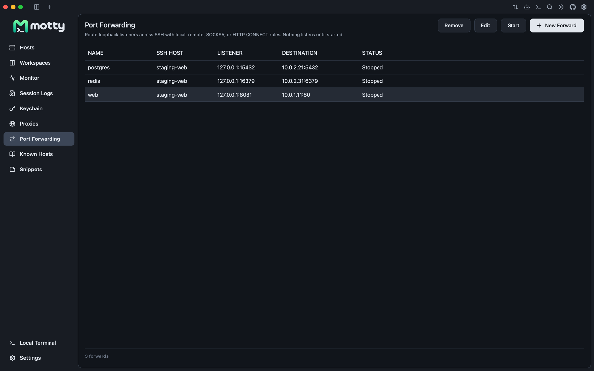

<div align="center">
  

  <p><a href="README.md">English</a> | <a href="README.zh-CN.md">简体中文</a> | 日本語</p>

  <p><strong>Motty：SSH、SFTP、ポートフォワーディング、VNC/RDP、そして AI アシスタントを、ひとつのネイティブウィンドウに。</strong></p>

  <p>
    <a href="https://qm.qq.com/cgi-bin/qm/qr?k=&group_code=1131573299"></a>
    <a href="https://docs.qq.com/doc/DVXBGYnFFdm9UWkVP"></a>
    <a href="https://discord.gg/6s5tn9H4p2"></a>
    <a href="https://linux.do"></a>
  </p>

  <p>
    <a href="assets/readme-hero.png"></a>
  </p>
</div>

> Motty はネイティブのデスクトップ SSH ワークスペースです。Go と
> [Viva](https://github.com/vivaui/viva) で作られているため、Electron のランタイムも、組み込みの
> ブラウザも、JavaScript のレイヤーもありません。ひとつのウィンドウに、ターミナル、ファイル、トンネル、
> リモートデスクトップ、アシスタントが収まっています。

## なぜ Motty なのか？

<table>
  <tr>
    <td width="50%" valign="top">
      <h3>🪶 設計からネイティブ</h3>
      <p>Viva は Metal、Direct3D、Vulkan と直接やり取りします。Motty は起動が速く、アイドル時に無駄なフレームの再描画を行わず、ブラウザエンジンを同梱せずに配布されます。</p>
    </td>
    <td width="50%" valign="top">
      <h3>🗂 セッションをひとつのウィンドウで</h3>
      <p>ターミナル、SFTP、フォワーディング、VNC/RDP、アシスタントが、ひとつのワークスペースを共有します。ファイルのために別のアプリを開く必要も、デスクトップのためにブラウザのタブを開く必要もありません。</p>
    </td>
  </tr>
  <tr>
    <td width="50%" valign="top">
      <h3>⌨️ キーボードのための設計</h3>
      <p>タブ、分割、SFTP、フォワーディング、アシスタントは、すべてコマンドパレットのコマンドです。マウスは必須ではありません。</p>
    </td>
    <td width="50%" valign="top">
      <h3>🔎 限界について正直に</h3>
      <p>リポジトリには、実機で検証済みのことと、まだ検証していないことが記載されています。リモートデスクトップのメモでは、プロトコルの未対応部分を隠さずに列挙しています。</p>
    </td>
  </tr>
</table>

## ✨ 機能

### 🖥 しっかりついてくるターミナル

本物の PTY セッション、256 色とトゥルーカラーの出力、代替スクリーン、5,000
行のスクロールバック、全角文字と結合文字、マウスレポート、入力
メソッド、PTY に追従するウィンドウのリサイズに対応しています。Synchronized updates（DECSET
2026）によって全画面の再描画をアトミックに保ち、kitty keyboard protocol によってキーの
押下、解放、曖昧さのない Escape/Alt キーを報告し、Windows のローカルシェルでは
win32-input-mode を使えます。フォントの合字は、固定幅のグリッドの中でシェーピングされます。
タブは並べ替え、水平または垂直の分割、ウィンドウ間の移動ができ、
再接続せずに復元できます。

**Settings > General > Tab orientation** で、水平のタブか、左サイドバーの垂直の
リストかを選べます。ターミナルのワークスペースでは、垂直のリストを展開したままにするか、
ターミナルのサイズを変えずにホバー時に展開されるアイコンレールに折りたたむかを選べます。
これらのレイアウトの設定は、このデバイスに保存されます。

**Group vertical tabs** は、General にある別の設定で、デフォルトではオフです。有効にすると、
同じ接続先に対する複数のタブが、折りたためるサーバーの見出しの下にまとめて表示されます。
接続が 1 つだけの場合は、単独のタブのままです。アカウント、プロトコル、ポート、ローカルシェルの環境が
異なるタブや、複数のサーバーにまたがる分割タブは、別々のままです。グループ化によって変わるのは
垂直のリストだけです。セッションが統合されたり切断されたりすることはなく、オフにするか水平モードに戻すと、
元の順序に戻ります。

ウィンドウとターミナルのツールバーのアイコンは、上部、左右どちらかの上側または下側のグループ、
下部バーのどちらかの端にドラッグできます。ドロップはマウスを離した時点で確定します。
Escape を押すか、ドックの外にドロップすると、レイアウトは変わりません。アイコンを右クリックすると、
移動や非表示、ツールバーのカスタマイズ、デフォルトのレイアウトへの復元ができます。
Settings > General でも、表示、順序、位置を設定できます。配置は
このデバイスに保存され、ターミナルの操作はアクティブな分割に従います。SFTP の
ツールバーは、表示と順序の設定を別に持っています。

Settings > General > Terminal toolbar > Customize では、左右のレールと下部バーについて、
移動したウィンドウの操作も含めて、小・中・大のサイズを選べます。
この選択はこのデバイスに保存されます。上部バーのアイコンは標準のサイズのままです。
接続の色はタブとホストのマーカーに残り、ターミナル、ファイル、
モニターのヘッダーにはニュートラルな背景が使われます。

保持された履歴の検索、HTTP/HTTPS と OSC 8 のリンクを開く、
Kitty/iTerm2/SIXEL の画像の表示、スニペットの送信、分割タブ全体への入力のブロードキャスト、
明示的なセッションの記録ができます。ターミナルには 11 種類の配色、キーワードの
ハイライト、オプションのインラインのコマンド候補があります。

### 🔑 ホストと認証

ホスト鍵は、認証情報を送信する前に、Motty 独自の `known_hosts` と照合して検証されます。
認証には、エージェントの鍵、ID ファイル、OpenSSH のユーザー
証明書（鍵ファイルに対応する `-cert.pub` は、OpenSSH と同じ方法で
ペアとして読み込まれます）、PuTTY の `.ppk` ファイル（バージョン 2 と 3、Argon2id を含む）、
パスワード、キーボードインタラクティブのやり取りに対応しています。複数の質問をするやり取り
（たとえば、同じ PAM スタックからのパスワードとワンタイムコード）は、質問ごとに 1 つの欄を持つ
1 つのダイアログとして表示されます。証明書を提示するホストは、その CA が `@cert-authority` として
登録されていれば、確認なしで接続します。未知の証明書については、ほかの未知の鍵と同じように、
フィンガープリントを示して確認を求めます。
ホストごとに、ローカルの ssh-agent をそのシェルにフォワードすることもできます（ホスト単位で設定し、
デフォルトではオフです）。

ホストは、グループ化、タグ付け、検索ができ、OpenSSH の設定、PuTTY、
Xshell、MobaXterm、WindTerm、Electerm、Netcatty からインポートできます。TOTP/HOTP のシードは
保管庫に保存して、自動で入力できます。保存したパスワードと鍵のパスフレーズは、
AES-256-GCM の保管庫に、対応するホストの下に保存されます。保管庫の鍵は
システムのシークレットストアに保存され、それがない場合は保管庫の隣の鍵ファイルに保存されます
（ポータブル版でも同様です）。
Electerm と Netcatty からのインポートでは、明示的な同意のもとで、読み取り可能な SSH のパスワードを保存できます。
再インポート時には、不足しているパスワードだけが補われます。

<p align="center">
  <a href="assets/readme-hosts.webp"></a>
</p>

### 🗂 別のアプリなしでファイルを扱う

複数選択、再帰的なアップロード/ダウンロード、上限付きの転送
キュー、再開、キャンセル/リトライ、名前の変更、削除、パーミッション、ブックマークに対応した SFTP のブラウジング。
ファイルを置き換えるときは、部分的なコピーをステージングし、再開したプレフィックスを検証し、
完全に同期されたコピーができてから初めてアトミックに名前を変更します。失敗した場合でも、
元のファイルはそのまま残ります。

ネイティブのエディターは、最大 1 MiB の UTF-8 のファイルを開き、ステージングの前後でリモートのファイルの
ハッシュを計算し、パーミッションを保持します。SFTP のないサーバーでは、
組み込みの SCP へのフォールバックを使えます。

パネルのその他のメニューから、表示中のフォルダーを、エディター独自の URL スキームを通じて
VS Code または Zed で開けます。エディターは **Settings > Files** で選択します。そこには
このコンピューターにインストールされているエディターが一覧表示され、選択するまではメニューの項目は
表示されません。サーバーは、SSH の設定でそのホスト自体（同じアドレス、ユーザー、ポート）に付けられた
エイリアスで、または `user@host` として開かれます。Motty だけが保持している踏み台ホストを経由して
接続するホストは、エディター自身の ssh がその踏み台を使わないため、拒否されます。

接続されたファイルパネルは、Bash と Zsh では、SSH のターミナルのフォルダーに自動的に追従できます。
**Settings > Files** には、準備ができた空のプロンプトで、ターミナルがファイルのナビゲーションに追従する、
デフォルトでオフの別のスイッチもあります。安全性と起動時の互換性の詳細については、
[フォルダーの同期](docs/terminal-folder-sync.md)をご覧ください。

### 🔀 フォワーディングと踏み台のチェーン

ローカル、リモート、SOCKS5、HTTP CONNECT のルールは、ループバックのみで、永続化され、
明示的に開始します。トンネルは、それを所有する SSH のタブとともに停止します。踏み台のルートでは、
すべてのホップを個別に検証して認証します。グローバルな送信用の SOCKS5/HTTP
プロキシで最初の接続を行うこともできます。保存した各ネットワークホストは、それを継承するか、
直接接続を強制するか、独自の SOCKS5/HTTP プロキシを使うか、`cloudflared access ssh` のような
プロキシコマンド（OpenSSH の `ProxyCommand`）を通じて接続するかを選べます。X11
フォワーディングでは、セッションごとの偽の Cookie を検証してから、ローカルの
Xauthority の Cookie に置き換えます。

<p align="center">
  <a href="assets/readme-forward.png"></a>
</p>

### 🖥 リモートデスクトップ

VNC は、RFB 3.3/3.7/3.8、None と VNC Authentication、Raw/CopyRect/RRE/
Hextile/ZRLE、デスクトップのリサイズ、ポインター、キーボード、テキストのクリップボードに対応しています。RDP は、
NLA を優先した TLS を使い、明示的に信頼すると判断したあとにサーバーの証明書をピン留めします。
どちらも、サーバーが自身のループバックでしか待ち受けていない場合は、SSH のホストを経由して接続できます。
正確な制限については、[docs/remote-desktop.md](docs/remote-desktop.md) をご覧ください。

### 🤖 アシスタントと MCP

**Ask** は、表示中のターミナルをコンテキストとして質問に答えます。**Agent** は、
さらにそのターミナルでコマンドを実行でき、リスクの分類と承認の
ゲートを備えています。Ask モードでは、リクエストにツールが必要なときに、アシスタントが Agent への切り替えを
求めることがあります。切り替えを承認すると、リクエストは Agent モードで再試行され、その選択は
記憶されます。実行したコマンドは、ターミナルの左の余白にアクセントの印を付けて、コマンドそのものとして
表示されます。Motty は、取得用のラッパーとマーカーを、画面と自身のコマンド履歴から
隠します。ただし、リモートのシェル自身の履歴は Motty の管理外です。ターミナルのテキストが
モデルに届く前に、鍵ファイル、代入、URL に埋め込まれた認証情報、よく知られたトークンの形式といった
シークレットは伏せられ、プロバイダーのキーは保管庫に保存されたままです。
長い会話では、決まった予算の範囲内で最新のラウンドを送信するため、セッションが
モデルのコンテキストを超えることはありません。最後の回答にカーソルを合わせると、トークンの使用量と
コピーボタンが表示され、保存した会話の名前を変更することもできます。

オプションの MCP サーバーで、同じツールを外部のエージェントに公開できます。デフォルトではオフで、
ループバックのみ、Bearer トークンで保護されており、observe と ask の
モードに対応しています。`motty mcp-serve` は、ウィンドウなしで同じことを行います：エージェントが
stdio で起動し、あなたがエージェントに開放したホストで動作します。ポートも
トークンも必要ありません。

### ☁️ バックアップと同期

暗号化された `.mottybak` のエクスポートに加えて、WebDAV、
S3 互換のストレージ、GitHub Gist を通じたレコード単位の同期に対応しています。レコードはハイブリッド論理クロックと
90 日間の削除の墓標を持つため、あるコンピューターが別のコンピューターを上書きすることなく、各コンピューターの状態が収束します。
タブ、ウィンドウのレイアウト、ショートカット、フォント、鍵のパス、クラウドの認証情報は、
ローカルにとどまります。

リモートの WebDAV と S3 のアドレスには、デフォルトで HTTPS が必要です。信頼できる LAN の
サービスを HTTP で使うには、その設定フォームの下部にある **Allow insecure remote HTTP** にチェックを入れてください。
接続は暗号化されず、認証の詳細が傍受される可能性があります。それでも、バックアップファイルはアップロード前に暗号化されます。
この選択は、このコンピューターに保存されます。

## 🚀 クイックスタート

1. **Hosts** を開き、**New host** を選びます。
2. 名前、アドレス、アカウント名を入力します。
3. 認証方法を選びます：実行中のエージェント、秘密鍵のファイル、またはパスワード。
4. 接続し、ホスト鍵のフィンガープリントをサーバーのものと照合します。一度だけ信頼するか、
   保存します。
5. タブがログインシェルで開きます。ワンタイムコードを求めるサーバーでは、
   追加の欄が自動的に表示されます。

コマンドパレットは、macOS では **Command+Shift+P**、それ以外では **Control+Shift+P** です。
デフォルトのショートカットは、macOS では Command、Windows/Linux では Control を使います。
すべてのショートカットは変更できます。

Windows では、**Settings → Terminal → Local shell** のドロップダウン（**Inline suggestions** の下）で
ローカルシェルを選びます。Motty は、PATH と一般的なインストール先のフォルダーから、
PowerShell、CMD、Git Bash などのインストール済みのシェルを検出し、
インストール済みの WSL のディストリビューションをそれぞれ個別の項目として一覧表示します。ファイルパネルは、
ディストリビューションの `\\wsl.localhost` 共有を通じて、WSL のターミナルのフォルダーにも追従します。
PowerShell に `wsl` と入力するのではなく、ここでディストリビューションを選んでください：
フォルダーを報告できるのは、Motty 自身が起動したシェルだけです。この選択はこの
コンピューターに保存され、新しいローカルターミナルや再接続したローカルターミナルに適用されます。

| 操作 | macOS | Windows / Linux |
| --- | --- | --- |
| コマンドパレット | Command+Shift+P | Control+Shift+P |
| ターミナル内を検索 | Command+F | Control+F |
| コマンド履歴 | Command+Shift+H | Control+Shift+H |
| ファイルパネル | Command+Shift+S | Control+Shift+S |
| 新しいウィンドウ | Command+Shift+N | Control+Shift+N |

## 📦 インストール

お使いのプラットフォーム向けのパッケージを
[リリースページ](https://github.com/t8y2/motty/releases)からダウンロードしてください：

| プラットフォーム | パッケージ |
| --- | --- |
| macOS (arm64, amd64) | `.dmg`、`.zip` |
| Windows (amd64, arm64) | `.exe` インストーラー、ポータブル版 `.zip`（データは `motty.exe` の隣の `motty-data` に保存） |
| Linux (amd64, arm64) | `.deb`、`.tar.gz` |

macOS のビルドは、リリースに認証情報がある場合に署名と公証が行われます。
Windows のビルドは、証明書が設定されている場合に署名されます。Linux のパッケージは
署名されていません。AUR と `.AppImage` はまだ提供していません。

パッケージマネージャーを使う場合：

```sh
brew install --cask t8y2/tap/motty
```

Homebrew から先に tap を信頼するよう求められた場合は、一度だけ `brew trust t8y2/tap` を実行してください。

```powershell
scoop bucket add t8y2 https://github.com/t8y2/scoop-bucket
scoop install t8y2/motty
```

cask は公証済みのディスクイメージをインストールし、自己更新するものとしてマークされているため、
インストールしたコピーは自動的に更新されます。Scoop はポータブル版をインストールします：その
`motty-data` フォルダーはバージョンをまたいで保持され、更新には `scoop update motty` を
使います。

### Motty が予期せず終了する場合

Motty は、データディレクトリの `logs` フォルダーにログを保存し、異常終了したあとはクラッシュレポートも保存します：
Windows では `%APPDATA%\motty\logs`、macOS では
`~/Library/Application Support/motty/logs`、Linux では `~/.config/motty/logs`
（ポータブル版ではプログラムの隣の `motty-data\logs`）です。バグの報告には、
`motty.log` と最新の `crash-*.log` を添付してください。プログラムがまったく
起動できない場合は、その理由をメッセージボックスで表示し、ログに書き込みます。

プログラムが消えて `crash.log` が空のままの場合は、Go が何かを書き込む前に、
ネイティブの障害（たとえばグラフィックドライバー）によってプロセスが終了しています。
Windows 11 22H2 以降では、Motty はその場合に Windows Error Reporting に
`%LOCALAPPDATA%\Motty\CrashDumps` へのダンプを依頼します。イベントビューアー（Windows ログ → Application）の
Application Error のイベントに、障害の原因となったモジュールが記録されます。よくある原因を
切り分けるには、`VIVA_SOFTWARE_RENDERING=1`（グラフィックドライバーを使わない）または
`VIVA_ACCESSIBILITY=0`（UI Automation のツリーを使わない）を設定して Motty を起動してください。ダンプは
プログラムのメモリのコピーです：共有する前に中身を確認してください。

## 🛠 ソースからのビルド

必要なもの：

- Go 1.26 以降。
- このリポジトリの隣に `../viva` としてチェックアウトした Viva フレームワーク。Viva は
  独自のライセンスを持つ別のプロジェクトで、同梱はしていません。
- Metal と Xcode のコマンドラインツールを備えた macOS、Windows 10/11、または
  X11 を備えた Linux。

```sh
git clone https://github.com/t8y2/motty
git clone https://github.com/vivaui/viva
cd motty
go run ./cmd/motty
```

テストとヘッドレスビルド：

```sh
gofmt -l .
go vet ./...
go test ./...
go test -race ./...

go build -tags vivahead -o /tmp/motty-head ./cmd/motty
python3 tools/headless_drive.py /tmp/motty-home tools/e2e/host_menu_move_e2e.txt
```

`tools/README.md` には、ヘッドレスのドライバー、フィクスチャ、エンドツーエンドの
スクリプトについて記載されています。パッケージングは Viva を通じて行います：

```sh
cd ../viva
go run ./cmd/viva package -C ../motty --format app,dmg
go run ./cmd/viva package -C ../motty --target linux --arch amd64 --format tar.gz,deb
```

### 開発ビルド

開発用のバイナリをビルドして起動するには：

```sh
make run
```

バイナリは `-tags dev` でビルドされるため、ウィンドウとトレイには `Motty Dev` と表示され、
Dock のアイコンには赤い `DEV` のバッジが付きます。ウィンドウ内のロゴとワードマークは
リリース版と同じなので、インターフェース自体は出荷されるものと同じ見た目のまま、
実行中のコピーをひと目で見分けられます。このリポジトリまたは `../viva` の Go ファイルが変更されたときに
再ビルドして再起動するには `make dev` を使ってください。ウォッチモードには
`fswatch` が必要です。ワンショットモードには不要です。`tools/dev.sh --once` は、`make run` と同じ
エントリーポイントです。

開発ビルドは、プラットフォームの設定ディレクトリの下にある `motty-dev` を使い、
リリースビルドの変更されない `motty` ディレクトリとは分かれています。保管庫の鍵も
別のシステムシークレットの名前空間を使います。デフォルトのコピーは、互いのデータベースを
アップグレードし合うことなく並べて実行できます。未使用のデフォルトの開発用
プロフィールがリリースのデータを見つけると、初回起動時のダイアログで **Import copy** または
**Start empty** を選べます。インポートでは、リリースのプロフィールを変更せずに読み込み、
ホスト、共有の設定、信頼済みの鍵をコピーし、必要に応じて保存済みの
パスワードを開発用の鍵で再暗号化します。開いているセッションやクラウドの
ログインはコピーしません。ダイアログを閉じると選択は先送りされます。失敗は表示されたまま残り、
未完了のインポートは、現在のホストやパスワードを置き換えることなく再開できます。
既存のプロフィールと、明示的に `MOTTY_DATA_DIR` で指定したプロフィールは自動ではインポートされませんが、
Backup & sync から暗号化されたバックアップを復元することはできます。

macOS では、標準のエントリーポイントが、`~/Library/Application Support/motty/development-signing` の下に
非公開のローカルな開発用の署名 ID を作成するか、既存のものを再利用します。
初回のアクセスでは、システムのキーチェーンの認可が 1 回必要になる場合があります。それ以降は、
同じ ID とロック解除されたキーチェーンが利用可能である限り、内容の異なる再ビルドでもその認可を再利用します。
これは、ロックされたキーチェーン、変更された ACL、明示的な ID の変更を回避するものではありません。
署名や検証に失敗した場合は、署名されていないビルドを黙って実行するのではなく、起動を停止します。

デフォルトの ID を作成せずに明示的な証明書を使うには、
`MOTTY_DEV_SIGN_IDENTITY='Developer ID Application: …' make run` を使ってください。
`MOTTY_DEV_SIGN_IDENTITY=none make run` は、意図的に署名なしで実行する場合にのみ使ってください。
その場合、キーチェーンの認可が繰り返し求められる可能性があると警告が表示されます。`go run ./cmd/motty`
はリリースと同じ動作で、`go run -tags dev ./cmd/motty` は署名の
ヘルパーを迂回するもので、診断のためだけに使うことを想定しています。

`MOTTY_DATA_DIR` は引き続きディレクトリを上書きします。破壊的なテストには、使い捨てのデータとテスト用の
認証情報を使ってください：同じビルドの種類のプロフィールは、システムシークレットの名前空間を
共有したままです。その共有アクセスが意図したものでない限り、開発ビルドで本番の
データを参照したり、本番のクラウド同期を設定したりしないでください。
ポータブル版の開発ビルドは、`motty-data` ではなく `motty-dev-data` を使います。

設定のエポック 23 では、ロスのないフィールドの更新が導入されました。JSON オブジェクトへの
互換性のある追加では、形式の番号を上げる必要がなくなりました。未知のフィールドやレコードは、
保存、同期、バックアップの復元を経ても残ります。競合する編集は、未読のデータを上書きするのではなく
失敗します。配列は引き続きアトミックなので、互換性のない要素の変更には
依然として新しいエポックが必要です。アプリケーションの書き込み側のバージョンは診断のためだけのものです。
古いエポック（19〜22 を含む）は一度だけアップグレードされます。すでにリリースされた古いバイナリは
エポック 23 を読み込めません。この保護を回避するために、データベースの形式の番号を編集しないでください。
[ストレージの互換性](tools/README.md#storage-compatibility)をご覧ください。

## 🔐 セキュリティ

- ホスト鍵の検証は、認証情報を送信する前に行われます。
- 保存したパスワードとパスフレーズは AES-256-GCM の保管庫に保存されます。その鍵は
  システムのシークレットストアに、それがない場合はデータフォルダー内の鍵ファイルに保存されます。
  そのフォルダーをコピーできる人は、誰でも保管庫を読み取れます。
- AI プロバイダーのキーは保管庫に保存されます。ターミナルのコンテキストはデフォルトで伏せられ、
  エージェントのコマンドは承認のゲートを通ります。
- MCP サーバーはデフォルトでオフで、ループバックのみ、Bearer トークンで保護されています。
- Motty にはアナリティクスはありません。オプションのアップデートの確認は GitHub Releases に接続し、
  デフォルトではオフです。

承認のゲートは安全のための制御であり、サンドボックスではありません。誤ったコマンドが許されない
ホストにエージェントを向けないでください。

脆弱性を報告するには、リポジトリの GitHub のプライベートな脆弱性報告を使ってください。認証情報、ホスト名、
ターミナルの出力は、公開の Issue に含めないでください。

## 🧱 アーキテクチャ

Motty は、SSH、認証、SFTP、ターミナルのエミュレーション、フォワーディング、
リモートデスクトップのプロトコル、永続化、製品のワークフローを担います。Viva は、ウィンドウ管理、
入力、テキスト/IME、フォーカス、レイアウト、コンポーネント、レンダリングを担います。再利用可能なデスクトップの
機能は、ここで重複して実装するのではなく、Viva に入れます。

| パス | 内容 |
| --- | --- |
| `cmd/motty` | アプリケーションのエントリーポイント、ヘッドレスモード、MCP ブリッジ、`mcp-serve` |
| `internal/sshconn` | SSH の接続、ホスト鍵、認証、プロキシ、踏み台のルート |
| `internal/term` | ターミナルエミュレーターとパーサー |
| `internal/rfb`, `internal/desktop/vnc` | VNC のプロトコルとデスクトップのバックエンド |
| `internal/rdpcore`, `internal/desktop/rdp` | RDP のプロトコル（MIT ライセンスのフォーク）とバックエンド |
| `internal/sftpclient`, `internal/scpclient` | SFTP と SCP のクライアント |
| `internal/forward` | ローカル、リモート、SOCKS5、HTTP CONNECT のフォワーディング |
| `internal/workbench` | アプリケーションの状態、画面、描画、入力 |
| `internal/ai` | アシスタント、ツール、リスクのゲート、MCP サーバー |
| `assets`, `docs`, `tools` | ブランディング、技術的なメモ、開発用のツール |
| `website` | motty.page に公開される静的なドキュメントサイト — [docs/website.md](docs/website.md) |

## 💬 コミュニティ

QQ グループ、Tencent Doc にある WeChat グループ、Discord サーバーは、
いずれも活動中です。

- QQ 群: [1131573299](https://qm.qq.com/cgi-bin/qm/qr?k=&group_code=1131573299)
- 微信群: [Tencent Doc の QR コードをスキャン](https://docs.qq.com/doc/DVXBGYnFFdm9UWkVP)
- Discord: [discord.gg/6s5tn9H4p2](https://discord.gg/6s5tn9H4p2)
- バグの報告と機能のリクエスト：
  [GitHub Issues](https://github.com/t8y2/motty/issues)
- セキュリティの報告：GitHub のプライベートな脆弱性報告

## 🤝 コントリビュート

Issue とプルリクエストを歓迎します。大きな変更の場合は、コードを書く前にアプローチを議論できるよう、
まず Issue を作成してください。

Issue を担当するには、Issue に `/claim` とコメントしてください：ボットがあなたを割り当てて
確認のコメントを投稿します。手放すには `/unclaim` を、リンクした
プルリクエストがマージされたら `/close` をコメントしてください。コマンドが拒否された理由と、ボットを
GitHub App として実行する方法：[docs/issue-commands.md](docs/issue-commands.md)。

プルリクエストを送る前に：

```sh
test -z "$(gofmt -l .)"
go vet ./...
go test ./...
go test -race ./...
```

SSH、プロトコル、製品のロジックはこのリポジトリに置いてください。デスクトップのフレームワークに
属する機能は、代わりに Viva に提案してください。

## 👥 コントリビューター

<a href="https://github.com/t8y2/motty/graphs/contributors">
  
</a>

## 📄 ライセンス

Motty は [Apache License, Version 2.0](LICENSE) のもとで公開されています。著作権と
サードパーティの表示については [NOTICE](NOTICE) をご覧ください。Motty の名前と
ロゴは Apache-2.0 のもとでライセンスされていません。サードパーティのアセットとコードには、
それぞれのライセンスが適用されます。

## 🙏 謝辞

Motty は [Viva](https://github.com/vivaui/viva) の上に作られています。RDP のコアは、MIT ライセンスの
[gopher-rdp](https://github.com/bouncyball-git/gopher-rdp) を改変したコピーです。
ライセンスと変更点の一覧は `internal/rdpcore/` にあります。インターフェースのアイコンは、
Lucide、Simple Icons、SVG Logos、Skill Icons、Devicon、selfh.st/icons、
Material Icon Theme、LobeHub Icons のものです。それぞれのライセンスと商標に関する注記は
`internal/workbench/icons/NOTICE` にあります。
