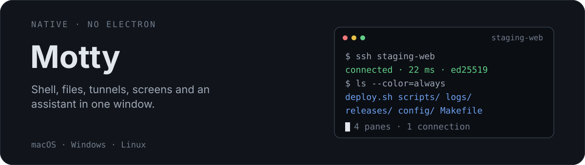
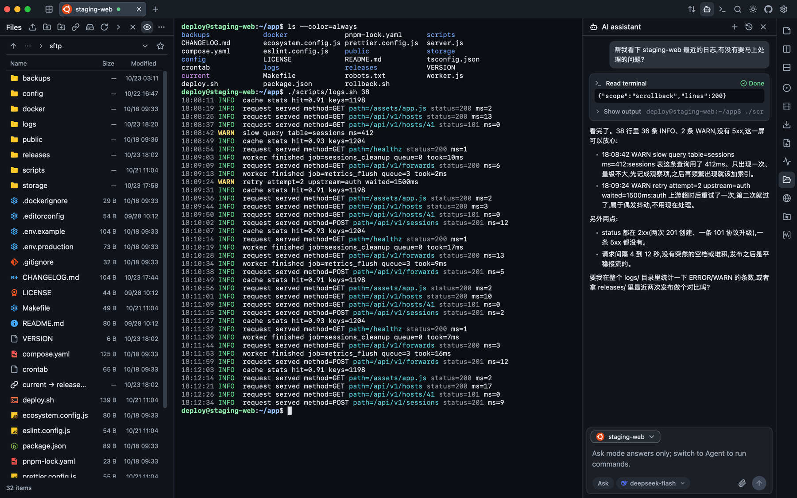
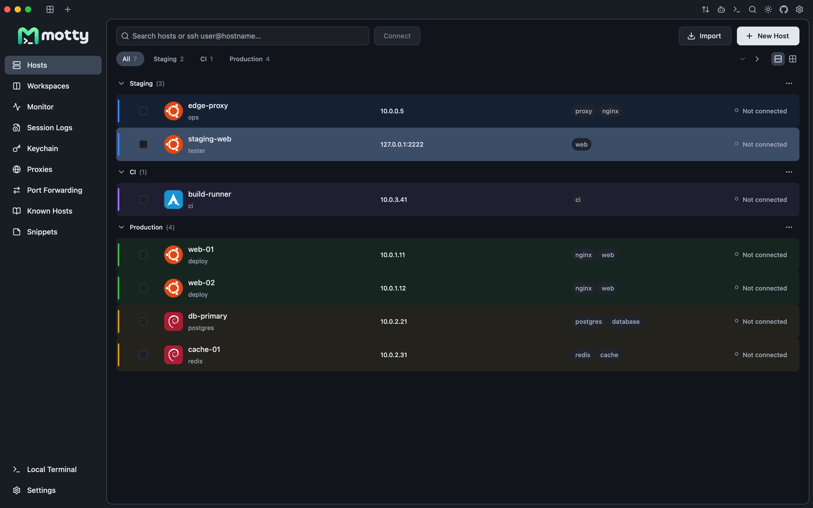
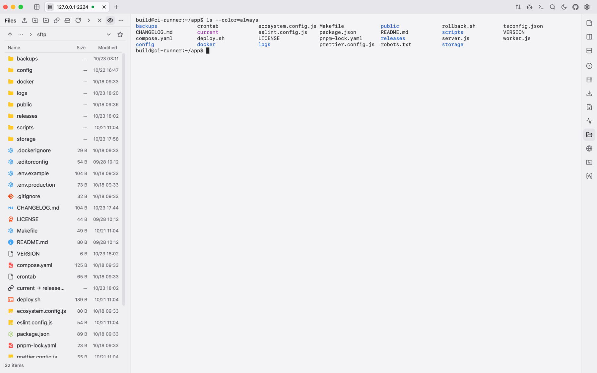
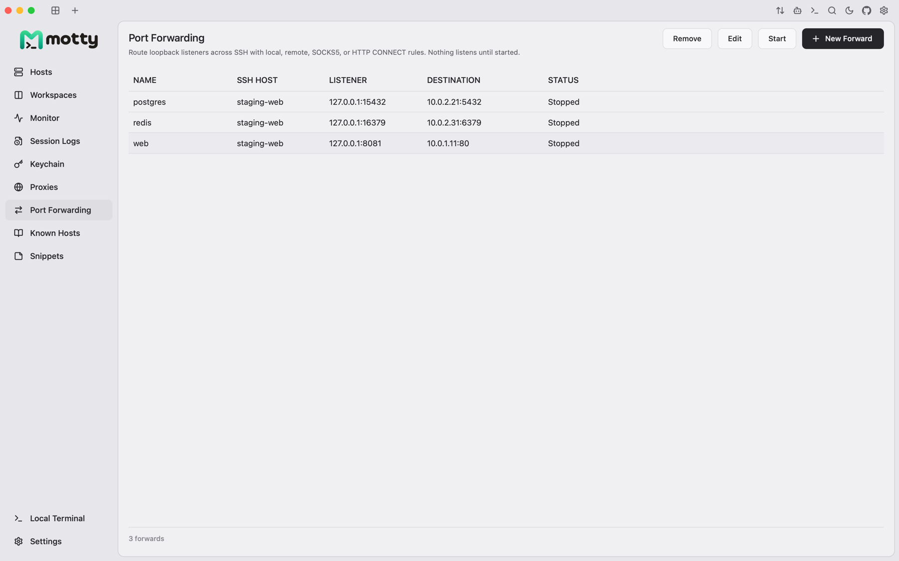
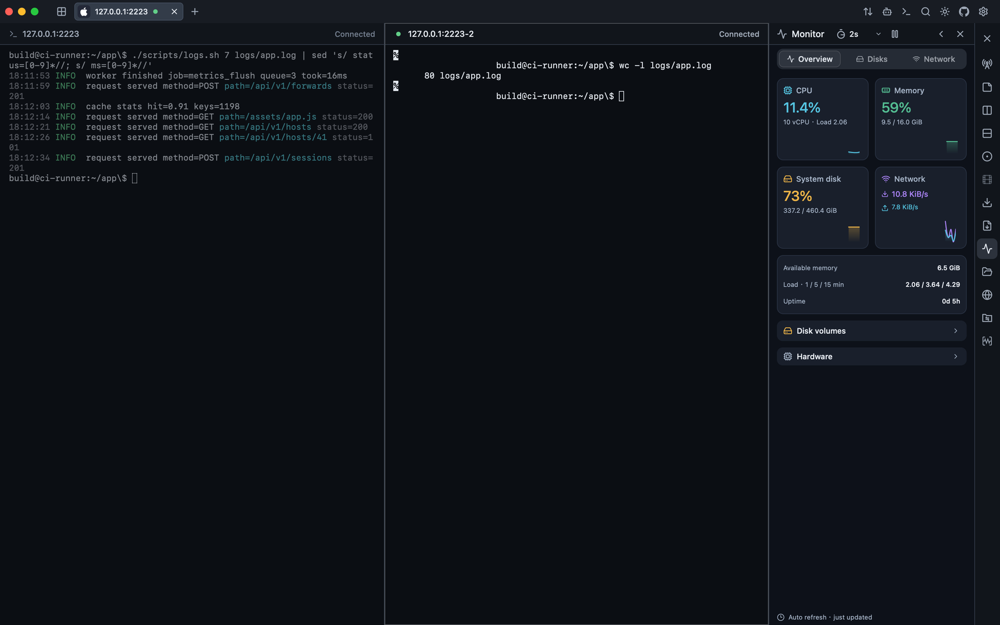
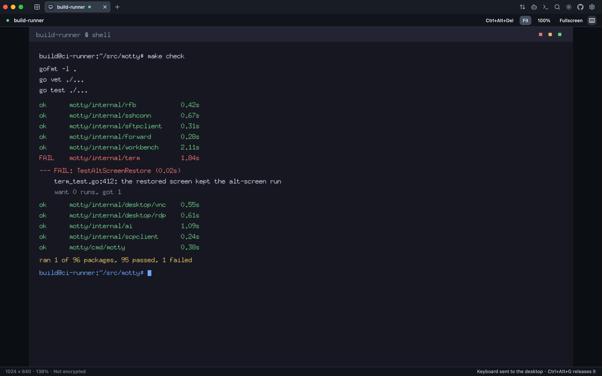
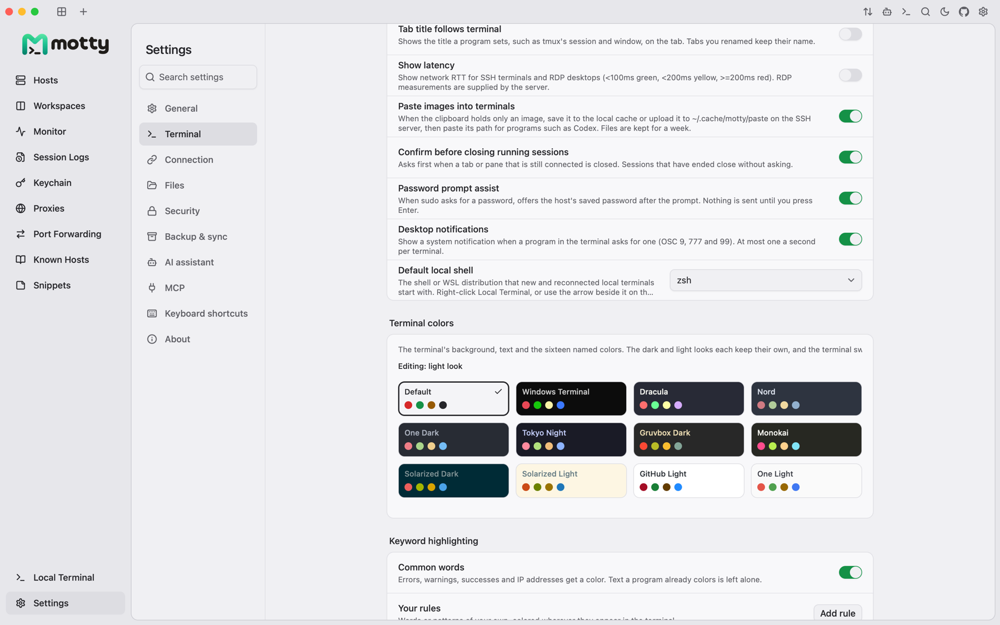

<div align="center">
  <p>English | <a href="README.zh-CN.md">简体中文</a> | <a href="README.ja.md">日本語</a></p>

  <p>
    <a href="assets/readme-hero.svg"></a>
  </p>

  <p>
    <a href="https://qm.qq.com/cgi-bin/qm/qr?k=&group_code=1131573299"></a>
    <a href="https://docs.qq.com/doc/DVXBGYnFFdm9UWkVP"></a>
    <a href="https://discord.gg/6s5tn9H4p2"></a>
    <a href="https://linux.do/t/topic/3086528/1"></a>
  </p>

  <p>
    <a href="assets/readme-hero.png"></a>
  </p>
  <p><sub>A real session: the file panel, a shell following a deploy log, and the assistant reading the same terminal.</sub></p>
</div>

Motty is a desktop SSH client. The terminal, the SFTP panel, port forwards,
remote desktops and an AI assistant share one window, so a session does not
need a second app for files or a browser tab for a screen.

The full documentation lives at <https://motty.page/en/docs>; this file covers
the project, the packages and how to build it.

<table>
  <tr>
    <td width="50%" valign="top">
      <a href="assets/readme-hosts.png"></a>
    </td>
    <td width="50%" valign="top">
      <a href="assets/readme-sftp-light.png"></a>
    </td>
  </tr>
  <tr>
    <td width="50%" valign="top">
      <a href="assets/readme-forward-light.png"></a>
    </td>
    <td width="50%" valign="top">
      <a href="assets/readme-monitor.png"></a>
    </td>
  </tr>
  <tr>
    <td width="50%" valign="top">
      <a href="assets/readme-desktop.png"></a>
    </td>
    <td width="50%" valign="top">
      <a href="assets/readme-settings-colors.png"></a>
    </td>
  </tr>
</table>

## Why Motty?

<table>
  <tr>
    <td width="50%" valign="top">
      <p><strong>Hosts stay organised.</strong> Groups, tags, colours and icons, importable from
      OpenSSH config, PuTTY, MobaXterm and four more. Passwords go to an
      AES-256-GCM vault; the key lives in the system secret store.</p>
    </td>
    <td width="50%" valign="top">
      <p><strong>A session you can watch.</strong> Split the pane, then read the host's
      CPU, memory, disk and network beside the shell that is using them.</p>
    </td>
  </tr>
  <tr>
    <td width="50%" valign="top">
      <p><strong>Screens too, when you need them.</strong> VNC and RDP connect, and both can
      ride an SSH host when the server only listens on its own loopback.</p>
    </td>
    <td width="50%" valign="top">
      <p><strong>Tunnels you can see.</strong> Local, remote, SOCKS5 and HTTP CONNECT
      rules bind to loopback only, are saved, and start when you say so. A tunnel
      stops with the SSH tab that owns it.</p>
    </td>
  </tr>
</table>

**Keyboard first.** Tabs, splits, SFTP, forwarding and the assistant are
commands in the palette; the mouse is optional. **Honest about limits:**
[docs/remote-desktop.md](docs/remote-desktop.md) lists what the VNC and RDP
implementations do not do, and the release notes say which platforms were
tested on real hardware. **Nothing phones home:** no analytics, and the update
check is off by default and asks GitHub Releases when you turn it on.

## Install

Download the package for your platform from the
[releases page](https://github.com/t8y2/motty/releases):

| Platform | Packages |
| --- | --- |
| macOS (arm64, amd64) | `.dmg`, `.zip` |
| Windows (amd64, arm64) | `.exe` installer, portable `.zip` (data kept in `motty-data` beside `motty.exe`) |
| Linux (amd64, arm64) | `.deb`, `.tar.gz` |

macOS builds are signed and notarized when the release has the credentials.
Windows builds are signed when a certificate is configured. Linux packages are
not signed. AUR and `.AppImage` are not available yet.

Through a package manager:

```sh
brew install --cask t8y2/tap/motty
```

If Homebrew asks you to trust the tap first, run `brew trust t8y2/tap` once.

```powershell
scoop bucket add t8y2 https://github.com/t8y2/scoop-bucket
scoop install t8y2/motty
```

The cask installs the notarized disk image and is marked as self-updating, so an
installed copy updates itself. Scoop installs the portable copy: its
`motty-data` folder is persisted across versions and `scoop update motty` is how
it updates.

## Quick start

1. Open **Hosts** and choose **New host**.
2. Enter a name, address and account name.
3. Pick authentication: the running agent, a private-key file or the password.
4. Connect and compare the host-key fingerprint with the server. Trust it once or
   save it.
5. The tab opens on the login shell. A server that asks for a one-time code gets
   the extra field automatically.

The command palette is **Command+Shift+P** on macOS and **Control+Shift+P**
elsewhere. Default shortcuts use Command on macOS and Control on Windows/Linux;
all of them are configurable.

| Action | macOS | Windows / Linux |
| --- | --- | --- |
| Command palette | Command+Shift+P | Control+Shift+P |
| Find in terminal | Command+F | Control+F |
| Command history | Command+Shift+H | Control+Shift+H |
| File panel | Command+Shift+S | Control+Shift+S |
| New window | Command+Shift+N | Control+Shift+N |

On Windows, choose the local shell from the dropdown in **Settings → Terminal
→ Local shell**, below **Inline suggestions**. Motty detects installed shells
such as PowerShell, CMD and Git Bash from PATH and common installation folders,
and lists each installed WSL distribution as its own entry. The file panel
follows a WSL terminal's folder too, through the distribution's `\\wsl.localhost`
share. Choose the distribution here, rather than typing `wsl` into PowerShell:
only a shell Motty starts itself can report its folder. The choice stays on this
computer and applies to new or reconnected local terminals.

## Features

### The terminal

Real PTY sessions, 256-colour and true-colour output, the alternate screen, 5,000
lines of scrollback, wide and combining characters, mouse reporting, input
methods and window resizing that follows the pty. Synchronized updates (DECSET
2026) keep a full-screen redraw atomic, the kitty keyboard protocol reports
presses, releases and unambiguous Escape/Alt keys, and Windows local shells can
use win32-input-mode. Font ligatures are shaped inside the fixed-pitch grid.
Tabs can be reordered, split horizontally or vertically, moved between windows
and restored without reconnecting.

Choose **Settings > General > Tab orientation** for horizontal tabs or a vertical
list in the left sidebar. In terminal workspaces, keep the vertical list expanded
or let it collapse to an icon rail that expands on hover without resizing the
terminal. These layout preferences stay on this device.

**Group vertical tabs** is a separate General setting, off by default. When
enabled, multiple tabs for the same connection target appear under a collapsible
server heading; a single connection stays a standalone tab. Different accounts,
protocols, ports or local shell environments, and split tabs spanning multiple
servers, stay separate. Grouping only changes the vertical list: it never merges
or disconnects sessions, and turning it off or returning to horizontal mode
restores the original order.

Window and terminal toolbar icons can be dragged to the top, either side's
upper or lower group, or either end of the bottom bar. A drop commits on release;
Escape or dropping outside a dock keeps the layout unchanged. Right-click an
icon to move or hide it, customize the toolbar, or restore its default layout.
Settings > General also controls visibility, order and position. Placements
stay on this device, and terminal actions follow the active split. The SFTP
toolbar keeps its separate visibility and ordering settings.

Settings > General > Terminal toolbar > Customize offers small, medium and large
sizes for both side rails and the bottom bar, including relocated window actions.
The choice stays on this device; top-bar icons keep their standard size.
Connection colors remain on tabs and host markers, while terminal, file and
monitor headers use neutral backgrounds.

Search the retained history, open HTTP/HTTPS and OSC 8 links, render
Kitty/iTerm2/SIXEL images, send snippets, broadcast input across a split tab, or
record a session explicitly. The terminal ships with more than two hundred
colour schemes, keyword highlighting and optional inline command suggestions.
Settings keeps a short set of quick picks and opens the rest in a left-hand
drawer; X resources files in the data folder's `schemes` directory join the
list.

### Hosts and authentication

Host keys are verified against Motty's own `known_hosts` before credentials are
sent. Authentication covers agent keys, identity files, OpenSSH user
certificates (the `-cert.pub` companion of a key file is picked up the way
OpenSSH pairs them), PuTTY `.ppk` files (versions 2 and 3, Argon2id included),
passwords and keyboard-interactive rounds. A round that asks several questions
— for example a password and a one-time code from the same PAM stack — is shown
as one dialog with one field per question. Hosts presenting a certificate
connect without a prompt once their CA is on file as `@cert-authority`, and an
unknown certificate is asked about with its fingerprint, like any unknown key.
A host can also forward the local ssh-agent to its shells, per host and off by
default.

Hosts can be grouped, tagged, searched and imported from OpenSSH config, PuTTY,
Xshell, MobaXterm, WindTerm, Electerm or Netcatty. TOTP/HOTP seeds can be stored in the
vault and filled automatically. Saved passwords and key passphrases go into an
AES-256-GCM vault, kept under the host they belong to; the vault key lives in the
system secret store, or in a key file beside the vault where there is none (and
in a portable copy).
Electerm and Netcatty imports can save readable SSH passwords with explicit
consent; re-import only fills missing passwords.

### Files

SFTP browsing with multi-select, recursive upload/download, a bounded transfer
queue, resume, cancel/retry, rename, delete, permissions and bookmarks.
Replacing a file stages a partial copy, verifies resumed prefixes and renames
atomically only after a complete synced copy. The previous file stays intact on
failure.

A native editor opens UTF-8 files up to 1 MiB, hashes the remote file before and
after staging, and preserves permissions. Servers without SFTP can use the
built-in SCP fallback. It edits code in a fixed-pitch grid with line numbers,
syntax colors, bracket matching, soft wrap, auto-indent that follows the file's
own tabs or spaces, paired brackets and quotes, Tab/Shift+Tab block indent,
line comment toggling (Cmd/Ctrl+/), line move/copy/delete (Alt+Up/Down,
Shift+Alt+Up/Down, Cmd/Ctrl+Shift+K), find and replace (Cmd/Ctrl+F, Ctrl+H) with
case, whole-word and regular-expression options, and go to line (Ctrl+G).

For files that the SSH account can read but cannot change (such as root-owned
configuration), switch on the **sudo** toggle beside the remote pane title (or
choose **Use sudo for remote files** in the file context menu) and confirm the
password. The same toggle stays selected while sudo is active; click it again
to return to normal mode. This switches the current file browser, its
transfers and open documents to a privileged SFTP server. Remote tools and the
terminal's resource monitor have a separate sudo control, while each dashboard
host requires its own confirmation. Sudo is off by default, never elevates the
terminal, and passwords are held only for the connection, not saved. The remote
host needs `sudo` and an OpenSSH
`sftp-server` executable; Windows servers and SCP-only servers cannot use
privileged SFTP. Server sudo policies may deny the required shell command.

The panel's more menu can hand the folder it shows to VS Code or Zed through the
editor's own URL scheme. Pick the editor under **Settings > Files**, which lists
the editors installed on this computer; until one is picked the menu item stays
hidden. A server is opened under the alias your SSH config gives that very host
(same address, user and port), or as `user@host`; a host reached through a jump
host that only Motty keeps is refused, because the editor's own ssh would not use
it.

The attached file panel can follow the SSH terminal's folder automatically for
Bash and Zsh. **Settings > Files** also offers a separate, default-off switch for
the terminal to follow file navigation at a ready, empty prompt. See
[folder synchronization](docs/terminal-folder-sync.md) for safety and startup
compatibility details.

### Forwarding and jump chains

Local, remote, SOCKS5 and HTTP CONNECT rules are loopback-only, persisted and
started explicitly. Tunnels stop with the SSH tab that owns them. Jump routes
verify and authenticate every hop independently. A global outbound SOCKS5/HTTP
proxy can carry the initial connection; each saved network host can inherit it,
force a direct connection, use its own SOCKS5/HTTP proxy, or connect through a
proxy command such as `cloudflared access ssh` (OpenSSH's `ProxyCommand`). X11
forwarding validates a per-session fake cookie before replacing it with the local
Xauthority cookie.

### Remote desktops

VNC supports RFB 3.3/3.7/3.8 (including RealVNC's 5.0 banner), None, VNC
Authentication and RealVNC RA2 system-account login, Raw/CopyRect/RRE/
Hextile/ZRLE, desktop resize, pointer, keyboard and text clipboard. RDP uses TLS
with NLA preferred and pins the server certificate after an explicit trust
decision; it also copies files to the server (paste them in the remote or drop
them on the picture). Both can connect through an SSH host when the server only listens on
its own loopback. See [docs/remote-desktop.md](docs/remote-desktop.md) for the
exact limits.

### Assistant and MCP

**Ask** answers questions with the visible terminal as context. **Agent** can
also run commands in that terminal, with a risk classification and an approval
gate. In Ask mode the assistant can ask to switch to Agent when a request needs
a tool; approving the switch retries the request in Agent mode, and the choice
is remembered. A run command is shown as the command itself with an accent mark
in the terminal's left margin; Motty hides its capture wrapper and marker from
the screen and from its own command history, though the remote shell's own
history is outside Motty's control.

Secrets are redacted before terminal text reaches a model — key files,
assignments, embedded URL credentials and well-known token formats — and
provider keys stay in the vault. Long conversations send their newest rounds
within a fixed budget, so a session cannot outgrow the model's context.
Hovering the last answer shows its token usage and a copy button, and saved
conversations can be renamed.

An optional MCP server exposes the same tools to external agents. It is off by
default, loopback-only, bearer-token protected, and supports observe and ask
modes. `motty mcp-serve` is the same idea without the window: an agent starts it
over stdio and it works on the hosts you opened to agents, with no port and no
token.
`list_hosts` lists saved SSH hosts explicitly opened to agents, without connecting,
and returns stable host IDs, names and addresses. Both HTTP and stdio MCP omit
unauthorized hosts. In windowed HTTP MCP, `list_sessions` lists only open terminals
and uses different session IDs; in `mcp-serve` it lists authorized hosts by host ID
for use with its command and file tools.

### Backup and sync

Encrypted `.mottybak` export, plus record-level sync through WebDAV,
S3-compatible storage, a GitHub Gist or a Gitee snippet. Records carry hybrid logical clocks and
90-day deletion tombstones, so computers converge without one overwriting the
other. Tabs, window layout, shortcuts, fonts, key paths and cloud credentials
stay local.

Remote WebDAV and S3 addresses require HTTPS by default. To use a trusted LAN
service over HTTP, check **Allow insecure remote HTTP** at the bottom of its
configuration form. The connection is unencrypted and authentication details may
be intercepted; the backup file is still encrypted before upload. This choice
stays on this computer.

## Build from source

Requirements:

- Go 1.26 or newer.
- The Viva framework checked out beside this repository as `../viva`. Viva is a
  separate project with its own licence and is not vendored.
- macOS with Metal and Xcode command-line tools, Windows 10/11, or Linux with
  X11.

```sh
git clone https://github.com/t8y2/motty
git clone https://github.com/vivaui/viva
cd motty
go run ./cmd/motty
```

Tests and the headless build:

```sh
gofmt -l .
go vet ./...
go test ./...
go test -race ./...

go build -tags vivahead -o /tmp/motty-head ./cmd/motty
python3 tools/headless_drive.py /tmp/motty-home tools/e2e/host_menu_move_e2e.txt
```

`tools/README.md` describes the headless driver, fixtures and end-to-end
scripts. Packaging goes through Viva:

```sh
cd ../viva
go run ./cmd/viva package -C ../motty --format app,dmg
go run ./cmd/viva package -C ../motty --target linux --arch amd64 --format tar.gz,deb
```

### Development builds

`make run` builds and launches one development binary: the window and tray say
`Motty Dev` and its Dock icon carries a red `DEV` badge, while the interface
itself looks like what ships. `make dev` rebuilds and restarts on change and
needs `fswatch`. Development data lives in `motty-dev` with its own
system-secret namespace, so a development build and a release build run side by
side without touching each other. See
[docs/development.md](docs/development.md) for the macOS development signing
identity, `MOTTY_DATA_DIR`, profile import, and the storage epoch 23 rules.

## Security

- Host-key verification happens before any credential is sent.
- Saved passwords and passphrases are stored in an AES-256-GCM vault; its key is
  in the system secret store, or in a key file in the data folder where the system
  has none: anyone who can copy that folder can read the vault.
- AI provider keys are in the vault. Terminal context is redacted by default, and
  agent commands pass through the approval gate.
- The MCP server is off by default, loopback-only and bearer-token protected.
- Motty has no analytics. The optional update check contacts GitHub Releases and
  is off by default.

The approval gate is a safety control, not a sandbox. Do not point an agent at a
host where a wrong command is unacceptable.

To report a vulnerability, use GitHub's private vulnerability reporting on the
repository. Please keep credentials, host names and terminal output out of public
issues.

## Architecture

Motty is written in Go on [Viva](https://github.com/vivaui/viva), which draws
through Metal, Direct3D and Vulkan. There is no Electron runtime, no embedded
browser and no JavaScript layer, and a window that is not being touched does
not paint.

Motty owns SSH, authentication, SFTP, terminal emulation, forwarding,
remote-desktop protocols, persistence and product workflows. Viva owns windowing,
input, text/IME, focus, layout, components and rendering. Reusable desktop
capabilities go into Viva rather than being duplicated here.

| Path | Contents |
| --- | --- |
| `cmd/motty` | application entry point, headless mode, MCP bridge and `mcp-serve` |
| `internal/sshconn` | SSH dialling, host keys, authentication, proxies and jump routes |
| `internal/term` | terminal emulator and parser |
| `internal/rfb`, `internal/desktop/vnc` | VNC protocol and desktop backend |
| `internal/rdpcore`, `internal/desktop/rdp` | RDP protocol (MIT-licensed fork) and backend |
| `internal/sftpclient`, `internal/scpclient` | SFTP and SCP clients |
| `internal/forward` | local, remote, SOCKS5 and HTTP CONNECT forwarding |
| `internal/workbench` | application state, screens, painting and input |
| `internal/ai` | assistant, tools, risk gate and MCP server |
| `assets`, `docs`, `tools` | branding, technical notes and development tooling |
| `website` | static documentation site published to motty.page — [docs/website.md](docs/website.md) |

## Troubleshooting

Motty keeps `motty.log` and, after an abnormal exit, a `crash-*.log` in the
`logs` folder of its data directory (`%APPDATA%\motty\logs` on Windows,
`~/Library/Application Support/motty/logs` on macOS, `~/.config/motty/logs` on
Linux). Attach both to a bug report. When a crash leaves `crash.log` empty, the
process died before Go could write anything — see
[docs/troubleshooting.md](docs/troubleshooting.md) for Windows Error Reporting
dumps and the `VIVA_SOFTWARE_RENDERING=1` / `VIVA_ACCESSIBILITY=0` bisection.

## Community

Questions and bug reports are welcome in any of these places.

- QQ 群: [1131573299](https://qm.qq.com/cgi-bin/qm/qr?k=&group_code=1131573299)
- 微信群: [scan the QR code in the Tencent Doc](https://docs.qq.com/doc/DVXBGYnFFdm9UWkVP)
- Discord: [discord.gg/6s5tn9H4p2](https://discord.gg/6s5tn9H4p2)
- Bugs and feature requests:
  [GitHub Issues](https://github.com/t8y2/motty/issues)
- Security reports: GitHub private vulnerability reporting

## Contributing

Issues and pull requests are welcome. Start with an issue for a large change so
the approach can be discussed before the code is written.

Comment `/claim` on an issue to take it: the bot assigns you and posts a
confirmation. Comment `/unclaim` to release it, and `/close` once your linked
pull request has merged. Why a command was refused, and how to run the bot as a
GitHub App: [docs/issue-commands.md](docs/issue-commands.md).

Before sending a pull request:

```sh
test -z "$(gofmt -l .)"
go vet ./...
go test ./...
go test -race ./...
```

Keep SSH, protocol and product logic in this repository. A capability that
belongs to the desktop framework should be proposed in Viva instead.

## Contributors

<a href="https://github.com/t8y2/motty/graphs/contributors">
  
</a>

## License

Motty is released under the [Apache License, Version 2.0](LICENSE). See
[NOTICE](NOTICE) for the copyright and third-party notice. The Motty name and
logo are not licensed under Apache-2.0. Third-party assets and code retain their
own licences.

## Acknowledgements

Motty is built on [Viva](https://github.com/vivaui/viva). Its RDP core is a modified
copy of [gopher-rdp](https://github.com/bouncyball-git/gopher-rdp), MIT licensed;
the licence and a list of changes are in `internal/rdpcore/`. Interface icons
come from Lucide, Simple Icons, SVG Logos, Skill Icons, Devicon, selfh.st/icons,
Material Icon Theme and LobeHub Icons; their licences and trademark notes are in
`internal/workbench/icons/NOTICE`.
