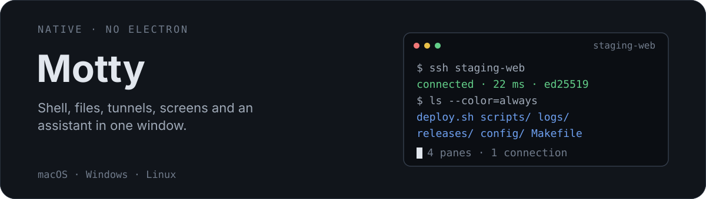
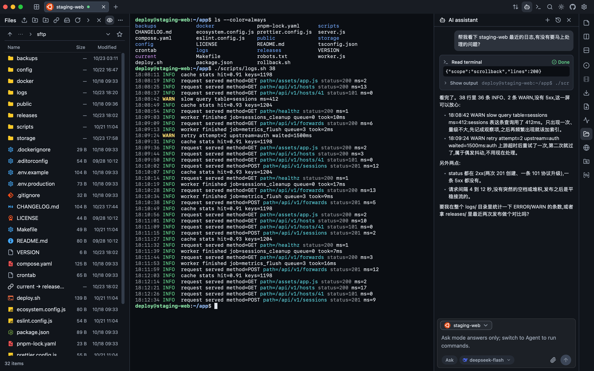
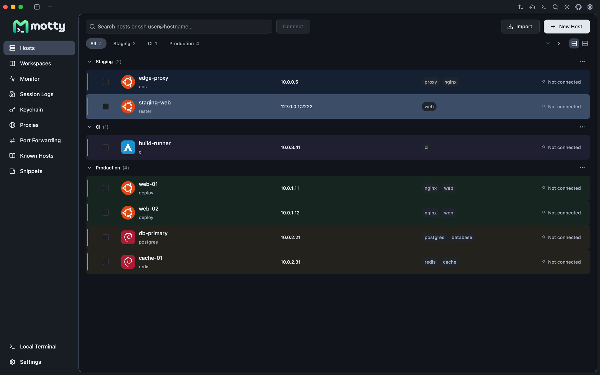
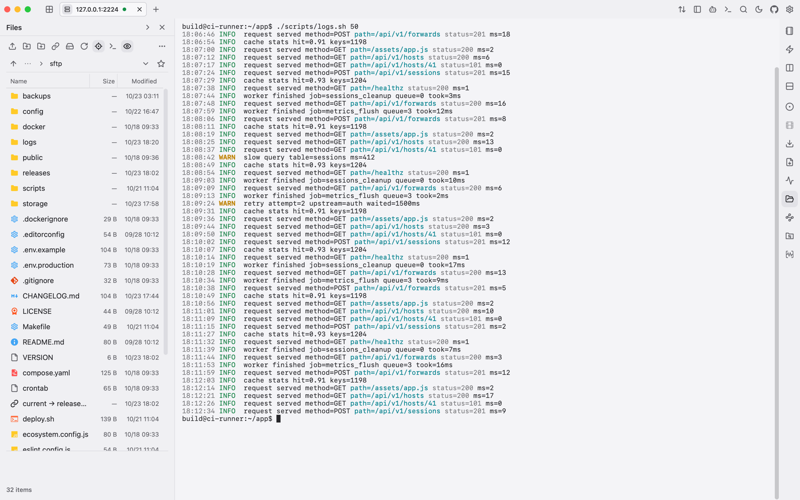
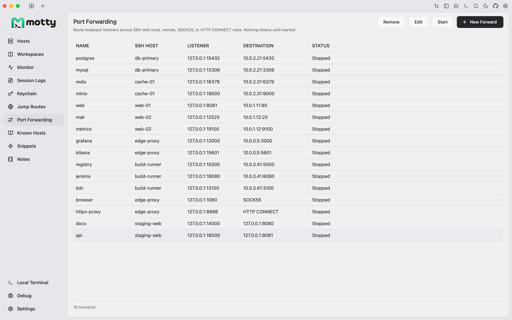
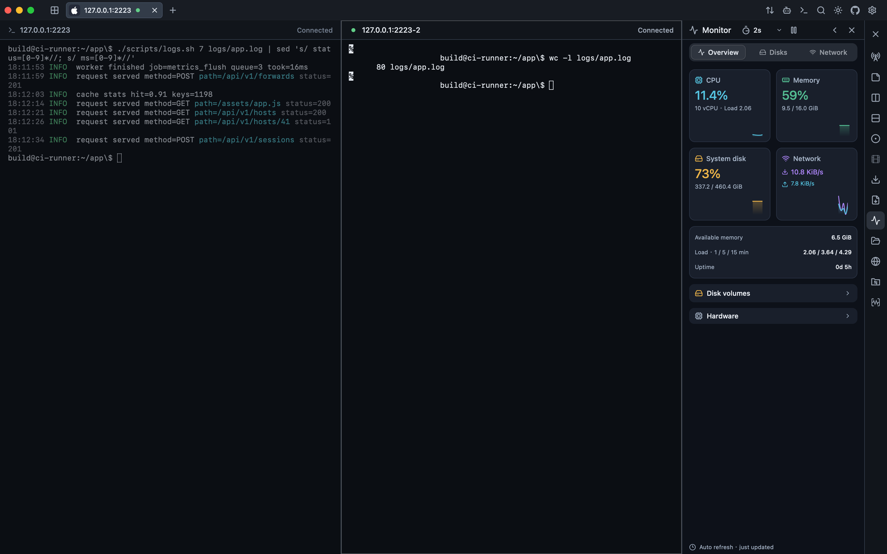
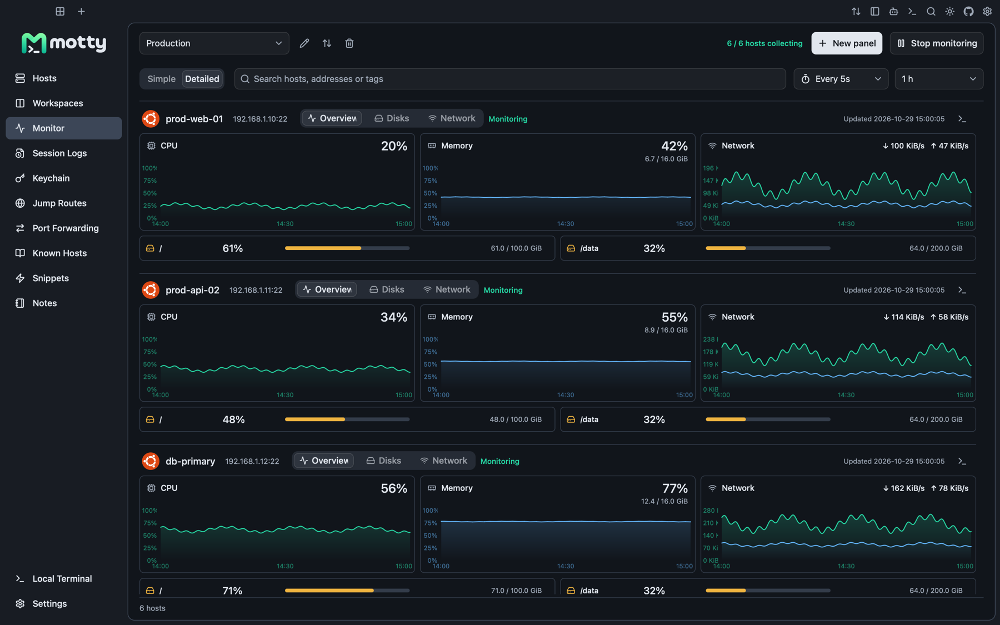
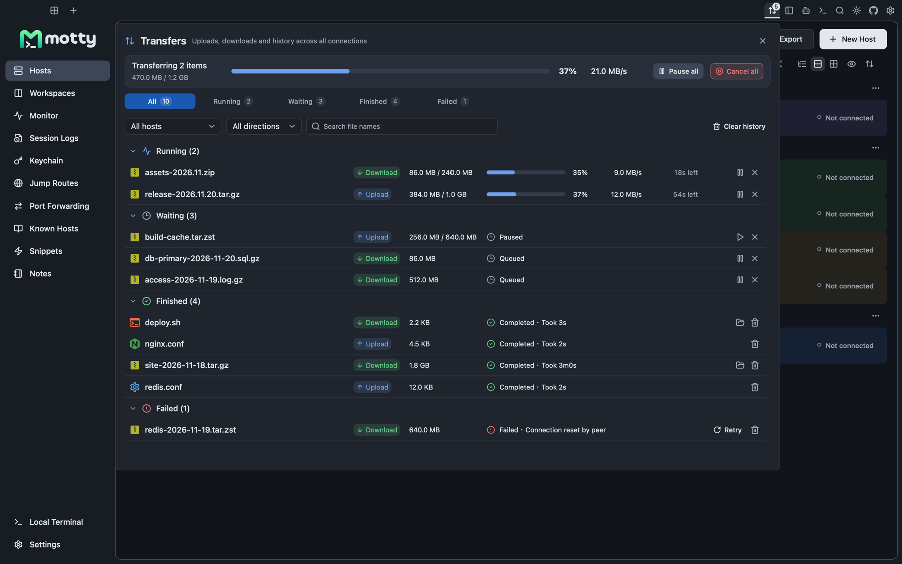
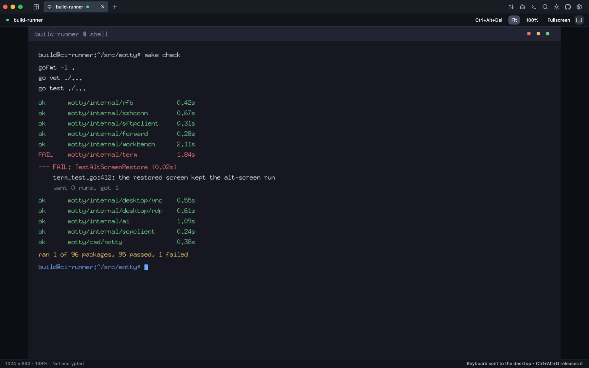
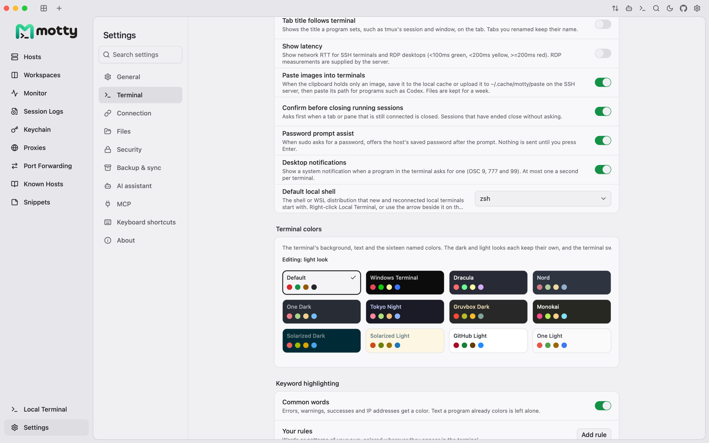

<div align="center">
  <p><a href="README.md">English</a> | <a href="README.zh-CN.md">简体中文</a> | <a href="README.ja.md">日本語</a> | Türkçe</p>

  <p>
    <a href="assets/readme-hero.svg"></a>
  </p>

  <p>
    <a href="https://qm.qq.com/cgi-bin/qm/qr?k=&group_code=1131573299"></a>
    <a href="https://docs.qq.com/doc/DVXBGYnFFdm9UWkVP"></a>
    <a href="https://discord.gg/6s5tn9H4p2"></a>
    <a href="https://linux.do/t/topic/3086528/1"></a>
  </p>

  <p>
    <a href="https://hellogithub.com/repository/t8y2/motty" target="_blank"></a>
    <a href="https://trendshift.io/repositories/324140?utm_source=trendshift-badge&amp;utm_medium=badge&amp;utm_campaign=badge-trendshift-324140" target="_blank" rel="noopener noreferrer"></a>
    <a href="https://atomgit.com/t8y2/motty" target="_blank" rel="noopener noreferrer"></a>
  </p>

  <p>
    <a href="assets/readme-hero.png"></a>
  </p>
  <p><sub>Gerçek bir oturum: dosya paneli, dağıtım günlüğünü takip eden bir kabuk ve aynı terminali okuyan asistan.</sub></p>
</div>

Motty bir masaüstü SSH istemcisidir. Terminal, SFTP paneli, bağlantı noktası yönlendirmeleri,
uzak masaüstleri ve bir yapay zeka asistanı tek bir pencereyi paylaşır; böylece bir oturum
dosyalar için ikinci bir uygulamaya veya ekran için bir tarayıcı sekmesine ihtiyaç duymaz.

Tam dokümantasyon <https://motty.page/en/docs> adresinde yer alır; bu dosya
projeyi, paketleri ve nasıl derleneceğini kapsar.

<table>
  <tr>
    <td width="50%" valign="top">
      <a href="assets/readme-hosts.png"></a>
    </td>
    <td width="50%" valign="top">
      <a href="assets/readme-sftp-light.png"></a>
    </td>
  </tr>
  <tr>
    <td width="50%" valign="top">
      <a href="assets/readme-forward-light.png"></a>
    </td>
    <td width="50%" valign="top">
      <a href="assets/readme-monitor.png"></a>
    </td>
  </tr>
  <tr>
    <td width="50%" valign="top">
      <a href="assets/readme-dashboard.png"></a>
    </td>
    <td width="50%" valign="top">
      <a href="assets/readme-transfers.png"></a>
    </td>
  </tr>
  <tr>
    <td width="50%" valign="top">
      <a href="assets/readme-desktop.png"></a>
    </td>
    <td width="50%" valign="top">
      <a href="assets/readme-settings-colors.png"></a>
    </td>
  </tr>
</table>

## Neden Motty?

<table>
  <tr>
    <td width="50%" valign="top">
      <p><strong>Sunucular düzenli kalır.</strong> OpenSSH yapılandırması, PuTTY, MobaXterm ve sekiz farklı
      kaynaktan içe aktarılabilen gruplar, etiketler, renkler ve simgeler. Parolalar bir
      AES-256-GCM kasasına gider; anahtar sistem gizli deposunda saklanır.</p>
    </td>
    <td width="50%" valign="top">
      <p><strong>İzleyebileceğiniz bir oturum.</strong> Bölme ekleyin ve sunucunun
      CPU, bellek, disk ve ağ durumunu onları kullanan kabuğun hemen yanında okuyun.</p>
    </td>
  </tr>
  <tr>
    <td width="50%" valign="top">
      <p><strong>İhtiyacınız olduğunda ekranlar da elinizin altında.</strong> VNC ve RDP bağlanır ve sunucu yalnızca
      kendi loopback arayüzünü dinlediğinde her ikisi de bir SSH sunucusu üzerinden tünellenebilir.</p>
    </td>
    <td width="50%" valign="top">
      <p><strong>Görebileceğiniz tüneller.</strong> Yerel, uzak, SOCKS5 ve HTTP CONNECT
      kuralları varsayılan olarak loopback'e bağlanır (dinleme adresi cihaz bazlı bir seçimdir),
      kaydedilir ve siz istediğinizde başlar. Bir tünel,
      kendisine sahip olan SSH sekmesiyle birlikte durur.</p>
    </td>
  </tr>
</table>

**Önce klavye.** Sekmeler, bölmeler, SFTP, yönlendirme ve asistan komut
paletindeki komutlardır; fare isteğe bağlıdır. **Ağ değiştiğinde Mosh:**
bir SSH sunucusu terminalini Mosh üzerinden taşıyabilir; Wi-Fi, erişim noktası ve
VPN değişiklikleri boyunca oturumu korur ve yavaş bağlantılarda yankı gelmeden önce
yazılanları çizer; [docs/mosh.md](docs/mosh.md) böyle bir oturumun neleri taşımadığını listeler.
**Sınırlar konusunda dürüst:**
[docs/remote-desktop.md](docs/remote-desktop.md) VNC ve RDP uygulamalarının neleri
yapmadığını listeler ve sürüm notları hangi platformların gerçek donanımda test
edildiğini belirtir. **Hiçbir şey dışarıya veri göndermez:** analiz yoktur ve güncelleme
denetimi varsayılan olarak kapalıdır; açtığınızda GitHub Releases'ı sorgular.

## Kurulum

Platformunuza uygun paketi
[sürümler sayfasından](https://github.com/t8y2/motty/releases) indirin:

| Platform | Paketler |
| --- | --- |
| macOS (arm64, amd64) | `.dmg`, `.zip` |
| Windows (amd64, arm64) | `.exe` yükleyici, taşınabilir `.zip` (veriler `motty.exe` yanındaki `motty-data` klasöründe tutulur) |
| Linux (amd64, arm64) | `.deb`, `.tar.gz` |

Windows paketleri Windows 10 veya Windows Server 2016 ya da üzerini gerektirir.

Sürümde gerekli kimlik bilgileri olduğunda macOS derlemeleri imzalanır ve noter onayından geçer.
Bir sertifika yapılandırıldığında Windows derlemeleri imzalanır. Linux paketleri
imzalı değildir. AUR ve `.AppImage` henüz mevcut değildir.

Bir paket yöneticisi aracılığıyla:

```sh
brew install --cask t8y2/tap/motty
```

Homebrew önce tap'e güvenmenizi isterse, bir kez `brew trust t8y2/tap` komutunu çalıştırın.

```powershell
scoop bucket add t8y2 https://github.com/t8y2/scoop-bucket
scoop install t8y2/motty
```

Cask, noter onaylı disk görüntüsünü kurar ve kendi kendini güncelleyen olarak işaretlenmiştir; böylece
yüklü kopya kendini günceller. Elle açılmış bir Windows taşınabilir ZIP sürümü,
imzalı bir sürüm mevcut olduğunda kendini güncelleyebilir ve `motty-data` klasörünü korur.
Eski taşınabilir derlemeler, bu özellik kullanılabilir olmadan önce bir kez manuel ZIP değişimi gerektirir.
Scoop taşınabilir kopyayı kurar ancak sürüm dizinlerini kendisi yönetir:
`motty-data` klasörü sürümler arasında korunur ve `scoop update motty` ile güncellenir.

## Hızlı başlangıç

1. **Hosts** (Sunucular) bölümünü açın ve **New host** (Yeni sunucu) seçeneğini seçin.
2. Bir ad, adres ve hesap adı girin.
3. Kimlik doğrulamayı seçin: çalışan aracı (agent), özel anahtar dosyası veya parola.
4. Bağlanın ve sunucu anahtarı parmak izini sunucuyla karşılaştırın. Bir kez güvenin veya
   kaydedin.
5. Sekme oturum açma kabuğunda açılır. Tek kullanımlık kod isteyen bir sunucu,
   ek alanı otomatik olarak alır.

Komut paleti macOS'ta **Command+Shift+P**, diğer sistemlerde **Control+Shift+P** kısayoludur.
Varsayılan kısayollar macOS'ta Command, Windows/Linux'ta Control tuşunu kullanır;
tümü yapılandırılabilir.

| İşlem | macOS | Windows / Linux |
| --- | --- | --- |
| Komut paleti | Command+Shift+P | Control+Shift+P |
| Terminalde bul | Command+F | Control+F |
| Komut geçmişi | Command+Shift+H | Control+Shift+H |
| Dosya paneli | Command+Shift+S | Control+Shift+S |
| Yeni pencere | Command+Shift+N | Control+Shift+N |

Windows'ta, **Settings → Terminal → Local shell** (Ayarlar → Terminal → Yerel kabuk) altındaki
**Inline suggestions** (Satır içi öneriler) seçeneğinin altında bulunan açılır menüden yerel kabuğu seçin. Motty;
PowerShell, CMD ve Git Bash gibi yüklü kabukları PATH ve yaygın kurulum klasörlerinden algılar
ve yüklü her WSL dağıtımını kendi girişi olarak listeler. Bir sekme veya kenar çubuğu
satırı kabuğun kendi işaretini, bir dağıtım ise kendi logosunu gösterir. Dosya
paneli, bir WSL terminalinin dağıtımı içinde, dağıtımın
`\\wsl.localhost` paylaşımı üzerinden açılır ve kabuğun bildirdiği klasörü takip eder; kaynak
izleyici ise dağıtımın kendisinden örnek alır. PowerShell'e `wsl` yazmak yerine
dağıtımı buradan seçin: yalnızca Motty'nin kendisinin başlattığı bir kabuk klasörünü
bildirebilir. Seçim bu bilgisayarda kalır ve yeni ya da yeniden bağlanan
yerel terminallere uygulanır.

## Özellikler

### Terminal

Gerçek PTY oturumları, 256 renk ve gerçek renk (true-colour) çıktısı, alternatif ekran, 5.000
satır geri kaydırma (scrollback), geniş ve birleştirici karakterler, fare bildirimi, giriş
yöntemleri ve pty'yi takip eden pencere yeniden boyutlandırma. Senkronize güncellemeler (DECSET
2026) tam ekran yeniden çizimini atomik tutar, kitty klavye protokolü
basmaları, bırakmaları ve belirsizliği olmayan Escape/Alt tuşlarını bildirir ve Windows yerel kabukları
win32-input-mode kullanabilir. Yazı tipi bitişik harfleri (ligatures) sabit genişlikli ızgara içinde şekillendirilir.
Sekmeler yeniden sıralanabilir, yatay veya dikey olarak bölünebilir, pencereler arasında taşınabilir
ve yeniden bağlanmadan geri yüklenebilir.

Yatay sekmeler veya sol kenar çubuğunda dikey liste için **Settings > General > Tab orientation**
seçeneğini kullanın. Terminal çalışma alanlarında dikey listeyi genişletilmiş tutun
veya terminali yeniden boyutlandırmadan üzerine gelindiğinde genişleyen bir simge çubuğuna daraltın.
Bu düzen tercihleri bu cihazda kalır.

**Group vertical tabs** (Dikey sekmeleri grupla) varsayılan olarak kapalı olan ayrı bir Genel ayardır.
Etkinleştirildiğinde, aynı bağlantı hedefi için birden fazla sekme daraltılabilir bir sunucu
başlığı altında görünür; tek bir bağlantı bağımsız bir sekme olarak kalır. Farklı hesaplar,
protokoller, bağlantı noktaları veya yerel kabuk ortamları ve birden fazla sunucuya yayılan bölünmüş sekmeler
ayrı kalır. Gruplama yalnızca dikey listeyi değiştirir: oturumları asla birleştirmez
veya bağlantılarını kesmez; kapatmak veya yatay moda dönmek
orijinal sırayı geri yükler.

Pencere ve terminal araç çubuğu simgeleri üste, her iki yanın üst veya alt grubuna
veya alt çubuğun her iki ucuna sürüklenebilir. Bırakıldığında yerleşir;
Escape tuşuna basmak veya bir yerleştirme alanının dışına bırakmak düzeni değiştirmeden korur.
Taşımak veya gizlemek, araç çubuğunu özelleştirmek ya da varsayılan düzenini geri yüklemek için bir simgeye sağ tıklayın.
Settings > General görünürlüğü, sırayı ve konumu da kontrol eder. Yerleşimler
bu cihazda kalır ve terminal eylemleri etkin bölmeyi takip eder. SFTP
araç çubuğu kendi ayrı görünürlük ve sıralama ayarlarını korur.

Settings > General > Terminal toolbar > Customize, taşınan pencere eylemleri dahil olmak üzere
hem yan çubuklar hem de alt çubuk için küçük, orta ve büyük boyutlar sunar.
Seçim bu cihazda kalır; üst çubuk simgeleri standart boyutlarını korur.
Bağlantı renkleri sekmelerde ve sunucu işaretçilerinde kalırken, terminal, dosya ve
izleyici başlıkları nötr arka planlar kullanır.

Saklanan geçmişte arama yapın, HTTP/HTTPS ve OSC 8 bağlantılarını açın,
Kitty/iTerm2/SIXEL görsellerini işleyin, kod parçacıkları (snippets) gönderin, bölünmüş bir sekme boyunca girdi yayınlayın veya
bir oturumu açıkça kaydedin. Terminal iki yüzden fazla
renk şeması, anahtar kelime vurgulama ve isteğe bağlı satır içi komut önerileriyle birlikte gelir.
Ayarlar kısa bir hızlı seçim kümesi tutar ve geri kalanını sol taraftaki bir çekmecede açar;
veri klasörünün `schemes` dizinindeki X resources dosyaları da listeye katılır.

### Sunucular ve kimlik doğrulama

Kimlik bilgileri gönderilmeden önce sunucu anahtarları Motty'nin kendi `known_hosts` dosyasına karşı
doğrulanır. Kimlik doğrulama; aracı (agent) anahtarlarını, kimlik dosyalarını, OpenSSH kullanıcı
sertifikalarını (bir anahtar dosyasının `-cert.pub` eşlikçisi OpenSSH'in eşleştirdiği şekilde alınır),
PuTTY `.ppk` dosyalarını (sürüm 2 ve 3, Argon2id dahil), parolaları ve klavye-etkileşimli turları kapsar.
Birden fazla soru soran bir tur — örneğin aynı PAM yığınından bir parola ve tek kullanımlık bir kod —
soru başına bir alan içeren tek bir iletişim kutusu olarak gösterilir. Sertifika sunan sunucular,
CA'ları `@cert-authority` olarak kayıtlı olduğunda istem olmadan bağlanır ve bilinmeyen bir sertifika,
herhangi bir bilinmeyen anahtar gibi parmak iziyle sorulur.
Bir sunucu ayrıca yerel ssh-agent'ı kabuklarına iletebilir; bu ayar sunucu bazlıdır ve varsayılan olarak kapalıdır.

Donanım güvenlik anahtarları (`sk-ssh-ed25519`, `sk-ecdsa-sha2-nistp256`) OpenSSH'in aracısı ve
`ssh-sk-helper` aracılığıyla kimlik doğrular. Bunlardan birini kullanan bir bağlantı için
Motty kısa ömürlü bir aracı başlatır, anahtarı `ssh-add` ile yükler ve pencerede PIN veya
parola cümlesi istemini gösterir; anahtar listesi bunu güvenlik anahtarı olarak işaretler.
Gereksinimler ve sınırlar için [güvenlik anahtarları](docs/security-keys.md) belgesine bakın.

Sunucular gruplandırılabilir, etiketlenebilir, aranabilir ve OpenSSH yapılandırması, PuTTY,
Xshell, MobaXterm, WindTerm, Electerm, Netcatty, SecureCRT, FinalShell, Xterminal veya XPipe'tan içe aktarılabilir.
TOTP/HOTP tohumları kasada saklanabilir ve otomatik olarak doldurulabilir. Kaydedilen parolalar ve anahtar parola cümleleri,
ait oldukları sunucu altında tutulan bir AES-256-GCM kasasına gider; kasa anahtarı sistem gizli
deposunda veya sistem deposu yoksa (ve taşınabilir kopyada) kasanın yanındaki bir anahtar dosyasında saklanır.
Electerm ve Netcatty içe aktarmaları, açık onayla okunabilir SSH parolalarını kaydedebilir;
yeniden içe aktarma yalnızca eksik parolaları doldurur. SecureCRT, FinalShell, Xterminal ve XPipe
kayıtlı parolalarını şifreli sakladığından, bu içe aktarmalar yalnızca bağlantıları taşır.

OpenSSH yapılandırma içe aktarma ve senkronizasyonu sunucu bazlı `ServerAliveInterval`,
`ServerAliveCountMax`, `IdentitiesOnly` ve yapılandırılmış kimlik dosyalarını korur. Açık bir
sıfır aralığı o sunucu için canlı tutmayı (keepalive) devre dışı bırakır; kısıtlı kimlikler, ilgisiz
aracı anahtarlarını sunmadan SSH aracısındaki eşleşen anahtarları kullanmaya devam eder. Otomatik kimlik
doğrulama kullanan bir sunucu aynı kısıtlamayı sunucu düzenleyicisinin Advanced (Gelişmiş) bölümünde ayarlayabilir:
aracı bu durumda yalnızca yapılandırılmış kimliklerle eşleşen anahtarları sunar, böylece büyük bir aracı
anahtar kümesi yerel anahtarlar denenmeden önce sunucunun kimlik doğrulama bütçesini tüketemez.

### Dosyalar

Çoklu seçim, özyinelemeli yükleme/indirme, yerel ve sunucu tarafları arasında kopyala-yapıştır,
sınırlı aktarım kuyruğu, devam ettirme, iptal/yeniden deneme, yeniden adlandırma, silme, izinler ve yer imleriyle
SFTP gezintisi. Bir dosyayı değiştirmek kısmi bir kopya hazırlar, devam ettirilen ön ekleri doğrular ve
yalnızca tam senkronize edilmiş bir kopyadan sonra atomik olarak yeniden adlandırır. Başarısızlık durumunda
önceki dosya bozulmadan kalır.

Yerel bir düzenleyici 1 MiB'a kadar UTF-8 dosyalarını açar, hazırlama öncesinde ve sonrasında uzak dosyanın
özetini (hash) alır ve izinleri korur. SFTP olmayan sunucular yerleşik SCP yedeğini kullanabilir.
Satır numaraları, sözdizimi renkleri, parantez eşleştirme, yumuşak kaydırma, dosyanın kendi sekmelerini veya
boşluklarını takip eden otomatik girintileme, eşleştirilmiş parantezler ve tırnaklar, Tab/Shift+Tab blok
girintileme, satır yorumu açma/kapama (Cmd/Ctrl+/), satır taşıma/kopyalama/silme (Alt+Up/Down,
Shift+Alt+Up/Down, Cmd/Ctrl+Shift+K), büyük/küçük harf, tam sözcük ve düzenli ifade seçenekleriyle
bul ve değiştir (Cmd/Ctrl+F, Ctrl+H) ve satıra git (Ctrl+G) özellikleriyle sabit genişlikli bir ızgarada kod düzenler.

SSH hesabının okuyabildiği ancak değiştiremediği dosyalar (root sahipliğindeki yapılandırmalar gibi) için,
uzak bölme başlığının yanındaki **sudo** anahtarını açın (veya dosya bağlam menüsünden
**Use sudo for remote files** seçeneğini seçin) ve parolayı onaylayın. Sudo etkinken aynı anahtar seçili kalır;
normal moda dönmek için tekrar tıklayın. Bu işlem geçerli dosya tarayıcısını, aktarımlarını ve açık belgeleri
ayrıcalıklı bir SFTP sunucusuna geçirir. Uzak araçlar, terminalin kaynak izleyicisi ve sunucu günlüğü paneli
ayrı bir sudo kontrolüne sahipken, her pano sunucusu kendi onayını gerektirir. Sudo varsayılan olarak kapalıdır,
terminali asla yükseltmez ve parolalar yalnızca bağlantı süresince tutulur, kaydedilmez. Uzak sunucu `sudo` ve bir
OpenSSH `sftp-server` çalıştırılabilir dosyası gerektirir; Windows sunucuları ve yalnızca SCP sunucuları
ayrıcalıklı SFTP kullanamaz. Sunucu sudo politikaları gerekli kabuk komutunu reddedebilir.

Panelin daha fazla menüsü, gösterdiği klasörü düzenleyicinin kendi URL şeması aracılığıyla VS Code veya Zed'e
iletebilir. Bu bilgisayarda yüklü düzenleyicileri listeleyen **Settings > Files** altından düzenleyiciyi seçin;
biri seçilene kadar menü öğesi gizli kalır. Bir sunucu, SSH yapılandırmanızın o sunucuya verdiği takma adla
(aynı adres, kullanıcı ve bağlantı noktası) veya `user@host` olarak açılır; yalnızca Motty'nin tuttuğu bir
atlama sunucusu (jump host) üzerinden ulaşılan bir sunucu reddedilir, çünkü düzenleyicinin kendi ssh'ı bunu kullanmaz.

Ekli dosya paneli, Bash ve Zsh için SSH terminalinin klasörünü otomatik olarak takip edebilir.
**Settings > Files** ayrıca terminalin hazır, boş bir istemde dosya gezinmesini takip etmesi için varsayılan
olarak kapalı ayrı bir anahtar sunar. Güvenlik ve başlangıç uyumluluk ayrıntıları için
[klasör senkronizasyonu](docs/terminal-folder-sync.md) belgesine bakın.

### Yönlendirme ve atlama zincirleri

Yerel, uzak, SOCKS5 ve HTTP CONNECT kuralları yalnızca loopback'e bağlıdır, kalıcıdır ve
açıkça başlatılır. Tüneller kendilerine sahip olan SSH sekmesiyle birlikte durur. Atlama rotaları
her adımı bağımsız olarak doğrular ve kimliğini kanıtlar. Genel bir giden SOCKS5/HTTP
proxy'si ilk bağlantıyı taşıyabilir; kaydedilen her ağ sunucusu bunu devralabilir,
doğrudan bağlantıyı zorlayabilir, kendi SOCKS5/HTTP proxy'sini kullanabilir veya `cloudflared access ssh`
(OpenSSH'in `ProxyCommand`'ı) gibi bir proxy komutu üzerinden bağlanabilir. X11
yönlendirmesi, yerel Xauthority çereziyle değiştirmeden önce oturum başına sahte bir çerezi doğrular.

### Uzak masaüstleri

VNC; RFB 3.3/3.7/3.8 (RealVNC'nin 5.0 başlığı dahil), None, VNC
Authentication ve RealVNC RA2 sistem hesabı oturum açmayı, Raw/CopyRect/RRE/
Hextile/ZRLE'yi, masaüstü yeniden boyutlandırmayı, işaretçiyi, klavyeyi ve metin panosunu destekler.
RDP, NLA tercih edilerek TLS kullanır ve açık bir güven kararından sonra sunucu sertifikasını sabitler;
ayrıca dosyaları sunucuya kopyalar (uzak tarafa yapıştırın veya görüntünün üzerine bırakın).
Sunucu yalnızca kendi loopback arayüzünü dinlediğinde her ikisi de bir SSH sunucusu üzerinden bağlanabilir.
Kesin sınırlar için [docs/remote-desktop.md](docs/remote-desktop.md) belgesine bakın.

### Asistan ve MCP

**Ask** (Sor), görünür terminali bağlam olarak kullanarak soruları yanıtlar. **Agent** (Ajan)
ayrıca risk sınıflandırması ve onay kapısı ile o terminalde komutlar çalıştırabilir. Ask modunda asistan,
bir istek araç gerektirdiğinde Agent moduna geçmek için izin isteyebilir; geçişi onaylamak isteği
Agent modunda yeniden dener ve seçim hatırlanır. Çalıştırılan bir komut, terminalin sol kenar boşluğunda
vurgulu bir işaretle komutun kendisi olarak gösterilir; Motty yakalama sarmalayıcısını ve işaretçisini
ekrandan ve kendi komut geçmişinden gizler, ancak uzak kabuğun kendi geçmişi Motty'nin kontrolü dışındadır.

Terminal metni bir modele ulaşmadan önce sırlar — anahtar dosyaları, atamalar, gömülü URL kimlik
bilgileri ve bilinen belirteç biçimleri — sansürlenir ve sağlayıcı anahtarları kasada kalır. Uzun sohbetler
en yeni turlarını sabit bir bütçe içinde gönderir, böylece bir oturum modelin bağlamını aşamaz.
Son yanıtın üzerine gelmek belirteç kullanımını ve bir kopyalama düğmesini gösterir ve kayıtlı
sohbetler yeniden adlandırılabilir.

İsteğe bağlı bir MCP sunucusu aynı araçları harici ajanlara sunar. Varsayılan olarak kapalıdır,
yalnızca loopback'tir, bearer-token korumalıdır ve observe ile ask modlarını destekler.
`motty mcp-serve` pencere olmadan aynı fikri sunar: bir ajan bunu stdio üzerinden başlatır
ve bağlantı noktası ya da belirteç olmadan ajanlara açtığınız sunucular üzerinde çalışır. Her iki MCP
sunucusu da arka plan işleri sunar: `terminal_start` hemen bir iş kimliği döndürür, `terminal_poll`
yazdırılanları ofsete göre okur ve `terminal_stop` komutu sonlandırır; böylece uzun bir komut sohbeti bekletmez.
`list_hosts`, ajanlara açıkça açılmış kayıtlı SSH sunucularını bağlanmadan listeler ve kararlı sunucu
kimlikleri, adları ve adresleri döndürür. Hem HTTP hem de stdio MCP yetkisiz sunucuları hariç tutar.
Pencereli HTTP MCP'de `list_sessions` yalnızca açık terminalleri listeler ve farklı oturum kimlikleri kullanır;
`mcp-serve` içinde ise komut ve dosya araçlarıyla kullanılmak üzere yetkili sunucuları sunucu kimliğine göre listeler.

### Yedekleme ve senkronizasyon

Şifrelenmiş `.mottybak` dışa aktarma, ayrıca WebDAV, S3 uyumlu depolama, GitHub Gist veya
Gitee snippet aracılığıyla kayıt düzeyinde senkronizasyon. Kayıtlar hibrit mantıksal saatler ve
90 günlük silme işaretçileri (tombstones) taşır, böylece bilgisayarlar biri diğerinin üzerine yazmadan
yakınsar. Sekmeler, pencere düzeni, kısayollar, yazı tipleri, anahtar yolları ve bulut kimlik bilgileri
yerelde kalır.

Uzak WebDAV ve S3 adresleri varsayılan olarak HTTPS gerektirir. Güvenilir bir yerel ağ hizmetini
HTTP üzerinden kullanmak için yapılandırma formunun altındaki **Allow insecure remote HTTP**
(Güvensiz uzak HTTP'ye izin ver) kutusunu işaretleyin. Bağlantı şifresizdir ve kimlik doğrulama
ayrıntıları ele geçirilebilir; yedek dosyası yüklenmeden önce yine de şifrelenir. Bu seçim
bu bilgisayarda kalır.

WebDAV indirmeleri AList/OpenList'in **302 redirect** (302 yönlendirme) politikasını destekler. En fazla beş
yönlendirme izlenir; başka bir kaynak hiçbir WebDAV kimlik bilgisi, çerez veya yönlendiren bilgisi almaz
ve HTTPS indirmeleri asla HTTP'ye yönlendirilmez. Yüklemeler ve bağlantı denetimleri yine de çapraz ana bilgisayar
yönlendirmelerini reddeder. Eşzamanlı güncellemeleri bulut sürücüsünün değil WebDAV dosyasının ETag'i korur;
yönlendirmede bulunmadığında indirmeden önce ve sonra WebDAV özellikleri kontrol edilir. Sunucu bu sürümü
sağlayamıyorsa, bunun yerine WebDAV politikasında **native proxy** seçeneğini seçin.

## Kaynaktan derleme

Gereksinimler:

- Go 1.26 veya daha yeni bir sürüm.
- Bu deponun yanında `../viva` olarak indirilmiş Viva çerçevesi. Viva kendi lisansına sahip ayrı
  bir projedir ve vendor olarak eklenmemiştir.
- Metal ve Xcode komut satırı araçlarıyla macOS, Windows 10/11 veya X11 ile Linux.

```sh
git clone https://github.com/t8y2/motty
git clone https://github.com/vivaui/viva
cd motty
go run ./cmd/motty
```

Testler ve başsız (headless) derleme:

```sh
gofmt -l .
go vet ./...
go test ./...
go test -race ./...

go build -tags vivahead -o /tmp/motty-head ./cmd/motty
python3 tools/headless_drive.py /tmp/motty-home tools/e2e/host_menu_move_e2e.txt
```

`tools/README.md` başsız sürücüyü, test fikstürlerini ve uçtan uca betikleri açıklar.
Paketleme Viva üzerinden yapılır:

```sh
cd ../viva
go run ./cmd/viva package -C ../motty --format app,dmg
go run ./cmd/viva package -C ../motty --target linux --arch amd64 --format tar.gz,deb
```

### Geliştirme derlemeleri

`make run` tek bir geliştirme ikili dosyasını derler ve başlatır: pencere ve sistem tepsisi
`Motty Dev` yazar ve Dock simgesi kırmızı bir `DEV` rozeti taşırken, arayüzün kendisi
yayınlanan sürüm gibi görünür. `make dev` değişiklikte yeniden derler ve yeniden başlatır;
`fswatch` gerektirir. Geliştirme verileri kendi sistem gizli ad alanıyla `motty-dev` içinde tutulur,
böylece bir geliştirme derlemesi ve bir yayın derlemesi birbirine dokunmadan yan yana çalışır. macOS
geliştirme imzalama kimliği, `MOTTY_DATA_DIR`, profil içe aktarma ve depolama epoch 23 kuralları
için [docs/development.md](docs/development.md) belgesine bakın.

## Güvenlik

- Sunucu anahtarı doğrulaması herhangi bir kimlik bilgisi gönderilmeden önce gerçekleşir.
- Kaydedilen parolalar ve parola cümleleri bir AES-256-GCM kasasında saklanır; anahtarı
  sistem gizli deposundadır veya sistemde yoksa veri klasöründeki bir anahtar dosyasındadır:
  bu klasörü kopyalayabilen herkes kasayı okuyabilir.
- Yapay zeka sağlayıcı anahtarları kasadadır. Terminal bağlamı varsayılan olarak sansürlenir ve
  ajan komutları onay kapısından geçer.
- MCP sunucusu varsayılan olarak kapalıdır, yalnızca loopback'tir ve bearer-token korumalıdır.
- Motty'de analiz yoktur. İsteğe bağlı güncelleme denetimi GitHub Releases ile iletişim kurar ve
  varsayılan olarak kapalıdır.

Onay kapısı bir güvenlik kontrolüdür, sanal alan (sandbox) değildir. Yanlış bir komutun kabul
edilemez olduğu bir sunucuya ajan yönlendirmeyin.

Bir güvenlik açığı bildirmek için depodaki GitHub'ın özel güvenlik açığı bildirme özelliğini kullanın.
Lütfen kimlik bilgilerini, sunucu adlarını ve terminal çıktılarını herkese açık issue'ların dışında tutun.

## Mimari

Motty, Metal, Direct3D ve Vulkan üzerinden çizim yapan [Viva](https://github.com/vivaui/viva)
üzerine Go ile yazılmıştır. Electron çalışma zamanı, gömülü tarayıcı veya JavaScript katmanı yoktur
ve dokunulmayan bir pencere yeniden boyanmaz.

Motty; SSH, kimlik doğrulama, SFTP, terminal öykünmesi, yönlendirme, uzak masaüstü protokolleri,
kalıcılık ve ürün iş akışlarının sahibidir. Viva; pencereleme, giriş, metin/IME, odak, düzen,
bileşenler ve işlemenin sahibidir. Yeniden kullanılabilir masaüstü yetenekleri burada çoğaltılmak
yerine Viva'ya gider.

| Yol | İçerik |
| --- | --- |
| `cmd/motty` | uygulama giriş noktası, başsız mod, MCP köprüsü ve `mcp-serve` |
| `internal/sshconn` | SSH arama, sunucu anahtarları, kimlik doğrulama, proxy'ler ve atlama rotaları |
| `internal/term` | terminal öykünücüsü ve ayrıştırıcı |
| `internal/rfb`, `internal/desktop/vnc` | VNC protokolü ve masaüstü arka ucu |
| `internal/rdpcore`, `internal/desktop/rdp` | RDP protokolü (MIT lisanslı çatal) ve arka ucu |
| `internal/sftpclient`, `internal/scpclient` | SFTP ve SCP istemcileri |
| `internal/forward` | yerel, uzak, SOCKS5 ve HTTP CONNECT yönlendirmesi |
| `internal/workbench` | uygulama durumu, ekranlar, boyama ve giriş |
| `internal/ai` | asistan, araçlar, risk kapısı ve MCP sunucusu |
| `assets`, `docs`, `tools` | marka varlıkları, teknik notlar ve geliştirme araçları |
| `website` | motty.page adresinde yayınlanan statik dokümantasyon sitesi — [docs/website.md](docs/website.md) |

## Sorun Giderme

Motty, veri dizininin `logs` klasöründe (Windows'ta `%APPDATA%\motty\logs`,
macOS'ta `~/Library/Application Support/motty/logs`, Linux'ta `~/.config/motty/logs`)
`motty.log` ve anormal bir çıkıştan sonra bir `crash-*.log` dosyası tutar. Bir hata raporuna her ikisini de ekleyin.
Bir çökme `crash.log` dosyasını boş bıraktığında süreç Go herhangi bir şey yazamadan ölmüştür — Windows Error Reporting
dökümleri ve `VIVA_SOFTWARE_RENDERING=1` / `VIVA_ACCESSIBILITY=0` ikili araması için
[docs/troubleshooting.md](docs/troubleshooting.md) belgesine bakın.

## Topluluk

Sorular ve hata raporları bu yerlerin herhangi birinde memnuniyetle karşılanır.

- QQ 群: [1131573299](https://qm.qq.com/cgi-bin/qm/qr?k=&group_code=1131573299)
- 微信群: [Tencent Doc'taki QR kodu tarayın](https://docs.qq.com/doc/DVXBGYnFFdm9UWkVP)
- Discord: [discord.gg/6s5tn9H4p2](https://discord.gg/6s5tn9H4p2)
- Hatalar ve özellik istekleri:
  [GitHub Issues](https://github.com/t8y2/motty/issues)
- Güvenlik raporları: GitHub özel güvenlik açığı bildirimi

## Katkıda Bulunma

Issue'lar ve pull request'ler memnuniyetle karşılanır. Kod yazılmadan önce yaklaşımın tartışılabilmesi için
büyük bir değişiklikte bir issue ile başlayın.

Üstlenmek için bir issue'ya `/claim` yorumu yapın: bot sizi atar ve bir onay yayınlar.
Bırakmak için `/unclaim`, bağlantılı pull request'iniz birleştirildikten sonra ise `/close` yorumu yapın.
Bir komutun neden reddedildiği ve botun GitHub App olarak nasıl çalıştırılacağı: [docs/issue-commands.md](docs/issue-commands.md).

Bir pull request göndermeden önce:

```sh
test -z "$(gofmt -l .)"
go vet ./...
go test ./...
go test -race ./...
```

SSH, protokol ve ürün mantığını bu depoda tutun. Masaüstü çerçevesine ait olan bir yetenek
bunun yerine Viva'da önerilmelidir.

## Katkıda Bulunanlar

<a href="https://github.com/t8y2/motty/graphs/contributors">
  
</a>

## Lisans

Motty, [Apache License, Version 2.0](LICENSE) altında yayınlanmıştır. Telif hakkı ve üçüncü taraf
bildirimi için [NOTICE](NOTICE) dosyasına bakın. Motty adı ve logosu Apache-2.0 kapsamında lisanslanmamıştır.
Üçüncü taraf varlıklar ve kodlar kendi lisanslarını korur.

## Teşekkürler

Motty, [Viva](https://github.com/vivaui/viva) üzerine inşa edilmiştir. RDP çekirdeği, MIT lisanslı
[gopher-rdp](https://github.com/bouncyball-git/gopher-rdp)'nin değiştirilmiş bir kopyasıdır;
lisans ve değişikliklerin listesi `internal/rdpcore/` içindedir. Arayüz simgeleri Lucide, Simple Icons,
SVG Logos, Skill Icons, Devicon, selfh.st/icons, Material Icon Theme ve LobeHub Icons'tan gelmektedir;
lisansları ve ticari marka notları `internal/workbench/icons/NOTICE` içindedir.
