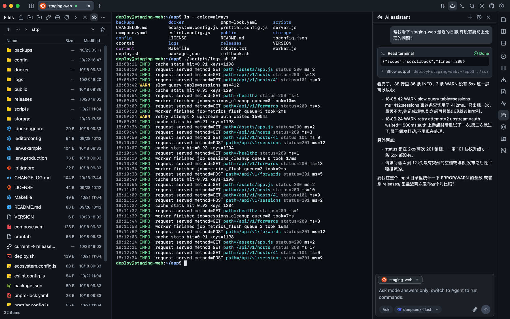
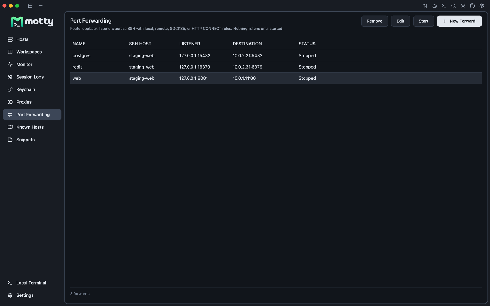

<div align="center">
  

  <p><a href="README.md">English</a> | 简体中文 | <a href="README.ja.md">日本語</a></p>

  <p><strong>Motty：SSH、SFTP、端口转发、VNC/RDP 和 AI 助手，都在一个原生窗口里。</strong></p>

  <p>
    <a href="https://qm.qq.com/cgi-bin/qm/qr?k=&group_code=1131573299"></a>
    <a href="https://docs.qq.com/doc/DVXBGYnFFdm9UWkVP"></a>
    <a href="https://discord.gg/6s5tn9H4p2"></a>
    <a href="https://linux.do"></a>
  </p>

  <p>
    <a href="assets/readme-hero.png"></a>
  </p>
</div>

> Motty 是一个原生桌面 SSH 工作区。它用 Go 编写，构建在
> [Viva](https://github.com/vivaui/viva) 上：没有 Electron、没有内嵌浏览器、没有
> JavaScript 层。一个窗口里同时放着终端、文件、隧道、远程桌面和 AI 助手。

## 为什么选择 Motty？

<table>
  <tr>
    <td width="50%" valign="top">
      <h3>🪶 原生，不是网页</h3>
      <p>Viva 直接调用 Metal、Direct3D 和 Vulkan。Motty 启动快，空闲时不空转，也不需要浏览器内核。</p>
    </td>
    <td width="50%" valign="top">
      <h3>🗂 一个窗口完成一次会话</h3>
      <p>终端、SFTP、转发、VNC/RDP 和助手共享同一个工作区，不用再开第二个文件工具或浏览器标签页。</p>
    </td>
  </tr>
  <tr>
    <td width="50%" valign="top">
      <h3>⌨️ 为键盘设计</h3>
      <p>标签、分屏、SFTP、转发和助手都是命令面板里的命令。鼠标是可选项。</p>
    </td>
    <td width="50%" valign="top">
      <h3>🔎 对边界诚实</h3>
      <p>文档会写清楚哪些在真实硬件上验证过、哪些没有，以及 VNC/RDP 具体缺什么。</p>
    </td>
  </tr>
</table>

## ✨ 功能

### 🖥 跟得上的终端

真正的 PTY、256 色和真彩色、备用屏、5000 行回滚、宽字符/组合字符、鼠标上报、
输入法和随 pty 变化的窗口大小。同步更新（DECSET 2026）让全屏重绘一次呈现；
kitty 键盘协议报告按下、释放和明确的 Esc/Alt；Windows 本地 shell 可以用
win32-input-mode。连字在固定网格内按单元格整形。标签可以重排、水平/垂直分屏、
在窗口之间移动，重启后恢复但不自动重连。

**设置 > 通用 > 标签方向** 可以选择水平或垂直标签。垂直模式将会话列在左侧，
在终端页可以固定展开或自动收起；自动收起时，鼠标悬停展开标签栏，不改变终端大小。
方向和收起偏好仅保存在本机。

通用设置中的 **“支持垂直聚合”** 是独立开关，默认关闭。开启后，同一连接目标的多个
标签自动归到可展开、收起的服务器节点下；只有一个连接时仍直接显示标签。
账号、协议、端口或运行环境不同的连接，以及包含不同服务器的分屏标签，保持独立。
聚合仅改变垂直栏的显示，不合并或断开连接；关闭开关或切回水平模式恢复原始顺序。

窗口和终端工具栏图标可以拖到顶部、左右两侧的上组或下组，以及底部的左组或右组。
松开鼠标才保存布局；按 Escape 或放到停靠区域之外会取消。右键图标可移动、隐藏、
自定义工具栏或恢复默认布局；设置 > 通用也可调整显示、顺序和位置。布局仅保存在
本机，终端操作跟随当前分屏。SFTP 工具栏继续使用独立的显示和排序设置。

设置 > 通用 > 终端工具栏 > 自定义可选择侧栏与底栏的小、中、大尺寸，也适用于
移入这些区域的窗口图标；尺寸仅保存在本机，顶栏图标保持标准大小。连接颜色仍
保留在标签页和主机标记中，终端、文件和监控顶栏使用中性背景。

支持保留历史搜索、HTTP/HTTPS 和 OSC 8 链接、Kitty/iTerm2/SIXEL 图片、片段、
分屏广播输入和显式录制。终端有十一套配色、关键词高亮和可选的行内命令建议。

### 🔑 主机与认证

发送凭据之前先验证服务器的主机密钥，信任记录保存在 Motty 自己的 `known_hosts`。
认证支持 agent、私钥文件、OpenSSH 用户证书（自动发现密钥文件旁的 `-cert.pub`，
配对方式与 OpenSSH 相同）、PuTTY `.ppk` 文件（版本 2 和 3，含 Argon2id 加密）、
密码和 keyboard-interactive；一次询问多个问题（例如密码和一次性验证码）会显示
成一个多字段对话框。服务器出示主机证书时，只要其 CA 已以 `@cert-authority` 记录
在案就直接连接；未知证书像未知密钥一样弹出指纹确认。主机还可以把本地 ssh-agent
转发给远端 shell，按主机开关，默认关闭。

主机可以分组、打标签、搜索，也可以从 OpenSSH config、PuTTY、Xshell、MobaXterm、
WindTerm、Electerm、Netcatty 导入。TOTP/HOTP 种子可以存入保险库并自动填充。密码和私钥口令
进入 AES-256-GCM 保险库，跟随各自的主机；密钥放在系统密钥存储，没有时（以及便携版）放在保险库旁的密钥文件里。
Electerm 和 Netcatty 的明文 SSH 密码可在明确确认后导入；重新导入只补齐缺失密码。

<p align="center">
  <a href="assets/readme-hosts.webp"></a>
</p>

### 🗂 文件不用另开应用

SFTP 支持多选、递归上传/下载、受限传输队列、续传、取消/重试、重命名、删除、
权限和书签。覆盖文件时先写同目录的 partial 文件，校验续传前缀，完整同步后再
原子重命名；失败时原文件保持不变。

内置编辑器支持最大 1 MiB 的 UTF-8 文件，保存前后分别读取并哈希远端文件，保留
权限；冲突时两边内容都不丢。没有 SFTP 子系统的服务器可以退回内置 SCP。编辑器按
等宽网格排版，带行号、语法着色、括号配对和软换行；回车自动缩进并沿用文件自己的
制表符或空格，括号与引号成对输入，Tab / Shift+Tab 缩进选中的行，Cmd/Ctrl+/
切换行注释，Alt+↑↓ 移动行、Shift+Alt+↑↓ 复制行、Cmd/Ctrl+Shift+K 删除行，
Cmd/Ctrl+F、Ctrl+H 查找与替换（区分大小写、全字匹配、正则），Ctrl+G 跳转到行。

文件面板可自动跟随 SSH Bash/Zsh 终端所在目录。**设置 > 文件** 还提供独立的
“终端跟随文件栏目录”开关，默认关闭；开启后仅在空闲且未输入命令的提示符下
同步终端目录。安全限制和启动兼容说明见[目录同步](docs/terminal-folder-sync.md)。

### 🔀 转发与跳板链

本地、远程、SOCKS5 和 HTTP CONNECT 规则只监听 loopback，持久保存并显式启动，
随所属 SSH 标签页一起停止。跳板链的每一跳单独验证主机密钥和认证。全局出站
SOCKS5/HTTP 代理可以承载第一条连接；每台已保存的网络主机也可以继承全局设置、
强制直连、使用自己的 SOCKS5/HTTP 代理，或通过 `cloudflared access ssh` 这样的
代理命令（OpenSSH 的 `ProxyCommand`）连接。X11 转发先校验每个会话的假 cookie，
再替换为本机 Xauthority 中的真 cookie。

<p align="center">
  <a href="assets/readme-forward.png"></a>
</p>

### 🖥 远程桌面

VNC 支持 RFB 3.3/3.7/3.8、None 和 VNC Authentication、Raw/CopyRect/RRE/
Hextile/ZRLE、桌面尺寸变化、指针、键盘和文本剪贴板。RDP 使用 TLS，优先 NLA，
服务器证书在你确认后固定；还支持把本机文件复制到服务器（在远程里粘贴，或拖到画面上）。两者都可以经 SSH 连接只监听自己 loopback 的服务器。
完整边界见 [docs/remote-desktop.md](docs/remote-desktop.md)。

### 🤖 AI 助手与 MCP

**Ask** 用当前终端作为上下文回答；**Agent** 还可以执行命令，经过风险分级和
审批门。发给模型的终端文本默认脱敏（私钥、赋值、URL 内嵌凭据与常见令牌格式），
模型 Key 存在保险库里。长会话只按固定预算携带最近的对话轮次，不会超出模型的
上下文窗口。悬停最后一条回答可查看本轮 token 用量并复制回答，保存的对话可以重命名。

可选 MCP 服务器把同样的工具交给外部 agent：默认关闭、只监听 loopback、要求
bearer token，支持 observe 和 ask 两种模式。`motty mcp-serve` 是不开窗口的同类做法：
agent 通过 stdio 启动它，它只使用你对 agent 开放的主机，没有端口，也没有 token。

### ☁️ 备份与同步

支持加密 `.mottybak` 导出，也可以通过 WebDAV、S3 兼容存储或 GitHub Gist 同步。
同步按记录合并，使用混合逻辑时钟和 90 天删除墓碑；标签页、窗口布局、快捷键、
字体、密钥路径和云服务凭据只留在本机。

WebDAV 和 S3 默认要求远程地址使用 HTTPS。使用局域网 HTTP 服务时，可以在配置
表单底部勾选“允许不安全的远程 HTTP”。HTTP 连接不加密，认证信息可能被窃听；
备份文件仍在本机加密后上传。此选择仅保存在本机。

## 🚀 快速开始

1. 打开 **Hosts**，选择 **New host**。
2. 填写名称、地址和账号。
3. 选择认证方式：运行中的 agent、私钥文件或密码。
4. 连接，核对服务器的主机密钥指纹；可以只信任本次或保存。
5. 标签页打开登录 shell。服务器要求一次性验证码时会自动多出一个字段。

命令面板在 macOS 上是 **Command+Shift+P**，其他系统是
**Control+Shift+P**。默认快捷键 macOS 用 Command，Windows/Linux 用 Control，
全部可以在设置里修改。

Windows 下可在 **设置 → 终端 → 本地 Shell**（“行内建议”下方）的下拉框中选择
本地终端使用的 Shell。Motty 会从 PATH 和常见安装目录中自动检测 PowerShell、
CMD、Git Bash 等已安装的 Shell，并把每个已安装的 WSL 发行版列为单独的选项。
选择 WSL 发行版后，文件面板同样会跟随终端所在目录（经由发行版的
`\\wsl.localhost` 共享访问）。请在这里选择发行版，而不是在 PowerShell 里输入
`wsl`：只有 Motty 自己启动的 Shell 才能上报所在目录。此配置仅保存在本机，对新建或重连的本地终端生效。

| 操作 | macOS | Windows / Linux |
| --- | --- | --- |
| 命令面板 | Command+Shift+P | Control+Shift+P |
| 终端内查找 | Command+F | Control+F |
| 命令历史 | Command+Shift+H | Control+Shift+H |
| 文件面板 | Command+Shift+S | Control+Shift+S |
| 新建窗口 | Command+Shift+N | Control+Shift+N |

## 📦 安装

从 [Releases](https://github.com/t8y2/motty/releases) 下载对应平台的包：

| 平台 | 包 |
| --- | --- |
| macOS（arm64、amd64） | `.dmg`、`.zip` |
| Windows（amd64、arm64） | 安装程序、便携版 zip（数据保存在 `motty.exe` 旁的 `motty-data`） |
| Linux（amd64、arm64） | `.deb`、`.tar.gz` |

macOS 包在发布带证书时签名并公证，Windows 包在配置证书时签名；Linux 包不签名。
AUR 和 `.AppImage` 暂不提供。

也可以用包管理器安装：

```sh
brew install --cask t8y2/tap/motty
```

如果 Homebrew 提示要先信任这个 tap，执行一次 `brew trust t8y2/tap`。

```powershell
scoop bucket add t8y2 https://github.com/t8y2/scoop-bucket
scoop install t8y2/motty
```

cask 安装的是已公证的磁盘映像，并标记为自行更新，安装后的副本会原地升级。Scoop 安装
的是便携版：`motty-data` 会在版本间保留，升级走 `scoop update motty`。

### Motty 意外退出时

Motty 会在数据目录的 `logs` 文件夹里保存日志，异常退出后还会保存崩溃报告：
Windows 在 `%APPDATA%\motty\logs`，macOS 在
`~/Library/Application Support/motty/logs`，Linux 在 `~/.config/motty/logs`
（便携版在程序旁的 `motty-data\logs`）。反馈问题时请附上 `motty.log` 和最新的
`crash-*.log`。如果程序根本无法启动，它会用对话框说明原因，并把原因写进日志。

如果程序消失而 `crash.log` 仍是空的，说明进程在 Go 来得及写任何东西之前就被原生错误
（例如显卡驱动）终止了。Windows 11 22H2 及以上时，Motty 会请求 Windows 错误报告把转储
保存到 `%LOCALAPPDATA%\Motty\CrashDumps`；事件查看器（Windows 日志 → 应用程序）里的
"Application Error" 事件会写出出错的模块。要排查常见原因，可在设置环境变量
`VIVA_SOFTWARE_RENDERING=1`（不用显卡驱动）或 `VIVA_ACCESSIBILITY=0`（不建立 UI Automation
树）后启动 Motty。转储是程序内存的副本，分享前请先自行确认。

## 🛠 从源码构建

要求：

- Go 1.26 或更新。
- Viva 检出在仓库旁边的 `../viva`。Viva 是独立项目，有自己的许可证，不会 vendoring
  进本仓库。
- macOS + Metal + Xcode 命令行工具、Windows 10/11，或 Linux + X11。

```sh
git clone https://github.com/t8y2/motty
git clone https://github.com/vivaui/viva
cd motty
go run ./cmd/motty
```

测试和无头构建：

```sh
gofmt -l .
go vet ./...
go test ./...
go test -race ./...

go build -tags vivahead -o /tmp/motty-head ./cmd/motty
python3 tools/headless_drive.py /tmp/motty-home tools/e2e/host_menu_move_e2e.txt
```

`tools/README.md` 里有 headless 驱动、fixture 和端到端脚本。打包走 Viva：

```sh
cd ../viva
go run ./cmd/viva package -C ../motty --format app,dmg
go run ./cmd/viva package -C ../motty --target linux --arch amd64 --format tar.gz,deb
```

### 开发构建

构建并启动一次开发版：

```sh
make run
```

该产物带 `dev` 标签，所以原生窗口和托盘显示 `Motty Dev`，Dock 图标右上角带一个
红色 `DEV` 角标。窗口内的 logo 与正式版用的是同一张图，界面看起来就是发布效果，
同时在 Dock 上一眼能认出跑的是哪个版本。
`make dev` 会在本仓库或 `../viva` 的 Go 文件变化时重新构建并重启；监听模式需要
`fswatch`，单次模式不需要。`tools/dev.sh --once` 与 `make run` 是同一个入口。

开发版默认使用系统配置目录下的 `motty-dev`，正式版仍使用原来的 `motty`。
系统密钥存储也使用独立命名空间；两个默认副本可以同时运行，不会互相升级数据库。
未使用的默认开发目录发现正式数据时，首次启动会提供“导入副本”和“空白开始”。
导入只读原目录，复制主机、共享设置及信任的密钥，并可将已保存的密码重新加密到
开发密码库；不会复制打开的会话或云同步登录。关闭弹窗表示稍后决定；失败会明确
显示，未完成的导入可以继续，不覆盖当前主机或密码。已有数据的开发目录及显式
`MOTTY_DATA_DIR` 不会自动导入，仍可通过“备份与同步”恢复加密备份。

macOS 标准入口会在
`~/Library/Application Support/motty/development-signing` 创建或复用私有本地开发
签名身份。首次访问可能需要完成一次系统钥匙串授权；在身份和钥匙串不变且已解锁时，
之后内容不同的重建会复用这次授权。它不会绕过钥匙串锁定、ACL 变更或显式更换身份。
签名或验证失败时入口会停止启动，不会静默运行未签名产物。

需要指定证书且不初始化默认身份时，使用
`MOTTY_DEV_SIGN_IDENTITY='Developer ID Application: …' make run`。只有明确要运行
未签名产物时才使用 `MOTTY_DEV_SIGN_IDENTITY=none make run`；入口会提示钥匙串授权
可能重复。普通 `go run ./cmd/motty` 是正式版行为，`go run -tags dev ./cmd/motty`
会绕过稳定签名入口，仅用于诊断。

`MOTTY_DATA_DIR` 仍可显式覆盖目录。破坏性测试必须使用临时数据和测试凭据；
同一构建类型内的多个目录仍共享该类型的系统密钥命名空间。除非明确希望共享访问，
不要将开发版指向正式目录或配置生产云同步。便携开发版识别 `motty-dev-data`，
不使用正式版的 `motty-data`。

配置兼容代际 23 引入无损字段更新：向 JSON 对象新增兼容字段不再必须提升格式号；
保存、同步和备份恢复会保留未知字段及记录。冲突修改会明确失败，不覆盖未读取的数据。
数组仍是整体值，不兼容的元素结构变化仍需提升兼容代际。写入程序版本只用于诊断。
包括 19–22 在内的旧格式需要一次升级，已发布的旧程序不能读取 23；不要手动修改
数据库格式号绕过保护。详见[存储兼容说明](tools/README.md#storage-compatibility)。

## 🔐 安全

- 发凭据之前先验证主机密钥。
- 保存的密码和口令进 AES-256-GCM 保险库，密钥在系统密钥存储里；系统没有时放在数据目录的密钥文件中，能拷走该目录的人就能读出保险库。
- AI 供应商 Key 存在保险库；终端上下文默认脱敏，agent 命令经过审批门。
- MCP 默认关闭、只监听 loopback，并要求 bearer token。
- 没有统计上报；可选的更新检查会访问 GitHub Releases，默认关闭。

审批门是安全控制，不是沙箱。不要把 agent 指向一台错一条命令就无法接受的主机。

漏洞请通过 GitHub 的 private vulnerability reporting 报告，不要在公开 issue 里放
凭据、主机名或终端输出。

## 🧱 架构

Motty 负责 SSH、认证、SFTP、终端模拟、转发、远程桌面协议、持久化和产品流程；
Viva 负责窗口、输入、文本/输入法、焦点、布局、组件和渲染。可复用的桌面能力应该
进入 Viva，而不是复制到应用里。

| 路径 | 内容 |
| --- | --- |
| `cmd/motty` | 应用入口、无头模式、MCP bridge 和 `mcp-serve` |
| `internal/sshconn` | SSH 拨号、主机密钥、认证、代理和跳板路由 |
| `internal/term` | 终端模拟器和解析器 |
| `internal/rfb`、`internal/desktop/vnc` | VNC 协议与桌面后端 |
| `internal/rdpcore`、`internal/desktop/rdp` | RDP 协议（MIT fork）与后端 |
| `internal/sftpclient`、`internal/scpclient` | SFTP 和 SCP 客户端 |
| `internal/forward` | 本地、远程、SOCKS5、HTTP CONNECT 转发 |
| `internal/workbench` | 应用状态、界面、绘制和输入 |
| `internal/ai` | 助手、工具、风险门和 MCP 服务器 |
| `assets`、`docs`、`tools` | 品牌、技术说明和开发工具 |

## 💬 社群

QQ 群、腾讯文档里的微信群和 Discord 服务器都已建好。

- QQ 群：[1131573299](https://qm.qq.com/cgi-bin/qm/qr?k=&group_code=1131573299)
- 微信群：[点进腾讯文档扫码](https://docs.qq.com/doc/DVXBGYnFFdm9UWkVP)
- Discord：[discord.gg/6s5tn9H4p2](https://discord.gg/6s5tn9H4p2)
- Bug 和功能请求：[GitHub Issues](https://github.com/t8y2/motty/issues)
- 安全报告：GitHub private vulnerability reporting

## 🤝 贡献

欢迎 issue 和 pull request。较大的改动请先开 issue 讨论方案。

在 issue 下评论 `/claim` 认领：机器人会把你设为 assignee 并回复确认。评论
`/unclaim` 释放认领，关联 PR 合并后评论 `/close` 关闭。命令被拒绝的原因、以及
如何用 GitHub App 运行机器人：[docs/issue-commands.md](docs/issue-commands.md)。

提交 PR 前：

```sh
test -z "$(gofmt -l .)"
go vet ./...
go test ./...
go test -race ./...
```

SSH、协议和产品逻辑留在这个仓库；属于桌面框架的能力请在 Viva 里提出。

## 📄 许可证

Motty 使用 [Apache License 2.0](LICENSE)。版权和第三方声明见 [NOTICE](NOTICE)。
Motty 名称和 logo 不包含在 Apache-2.0 授权里；第三方资源和代码保留各自的许可证。

## 🙏 致谢

Motty 构建在 [Viva](https://github.com/vivaui/viva) 上。RDP 核心是
[gopher-rdp](https://github.com/bouncyball-git/gopher-rdp) 的修改副本（MIT），
许可证和改动列表在 `internal/rdpcore/`。界面图标来自 Lucide、Simple Icons、
SVG Logos、Skill Icons、Devicon、selfh.st/icons、Material Icon Theme 和
LobeHub Icons，许可证与商标说明在 `internal/workbench/icons/NOTICE`。
