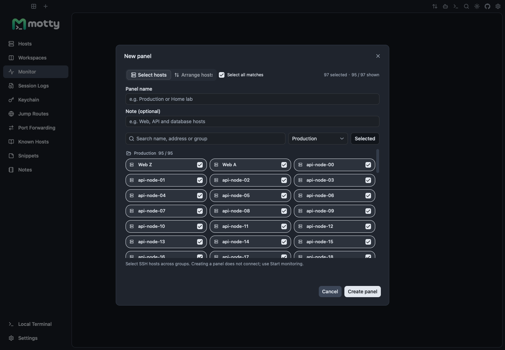
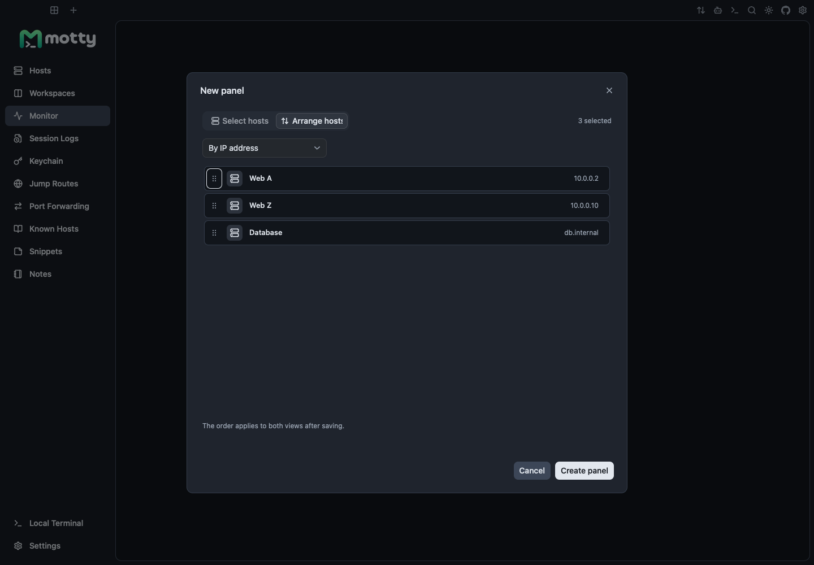
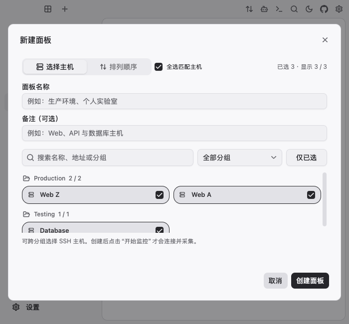

# Monitor Selection And Ordering Verification

Date: 2026-11-13

## Inputs

- Motty base: `7482302027c110a818d541b6ceef4b0bea5bb4c7`.
- Viva: `08ef0fa296f3305c87a7149c8f6b4296f566663e` (unchanged CI pin).
- Go: `go1.26.11 darwin/arm64`; native build verified as Mach-O arm64.
- Spec: [spec.md](spec.md); implementation: [plan.md](plan.md).
- Complete logs and headless frame JSON are retained locally under
  `/Users/ccq/Documents/ChatGPT/motty-782-690-evidence-20261113/782`.

## Results

| Check | Result |
| --- | --- |
| Dashboard baseline before implementation | PASS |
| New bulk and ordering tests against missing behavior | Expected FAIL, then PASS after implementation |
| Unavailable-host ordering regression | Expected FAIL, then PASS after fix |
| `go test -tags vivahead ./internal/workbench -run '^TestDashboard' -count=1` | PASS |
| `go test -p 2 ./... -count=1 -timeout 15m` | PASS |
| `go test -race -tags vivahead ./internal/workbench ./internal/monitoring ./internal/i18n -run 'TestDashboard\|TestPanel\|TestAll\|TestTranslations' -count=1 -timeout 5m` | PASS for matching tests; i18n has no matching tests and is covered by the full suite |
| `go vet ./...` | PASS |
| `go vet -tags dev ./internal/workbench` | PASS |
| `make test-dev` | PASS |
| `go build ./cmd/motty` | PASS |
| Formatting and `git diff --check` | PASS |

Viva emits an existing macOS SDK warning about deprecated Metal `didModifyRange:`;
it is not a compile or test failure. The first screenshot attempt without
`-tags vivahead` correctly reported no offscreen renderer; the final capture uses
the required tag. A test fixture initially used an invalid combined key string
and looked up a disabled control through a reachable-only lookup; both fixture
errors and subsequent passing reruns are retained rather than hidden.

## Headless Acceptance

`TestDashboardBulkHeadlessSelectsOffscreenMatches` clicks the group filter and
bulk checkbox with 96 eligible SSH hosts. It verifies all 95 Production matches,
including the last offscreen host, are selected; the off-filter Database and
unavailable saved ID survive clearing. It checks partial/checked/disabled states,
wheel scrolling and cancel without saving or opening a connection.

`TestDashboardBulkHeadlessOrdersAndPersists` types a panel name, selects hosts,
opens and dismisses the order menu, chooses IP order using keyboard navigation,
performs manual keyboard reordering, chooses name order with the pointer, saves
and reloads the stored order. Existing native-headless tests continue to verify
pointer drag reordering, canceled drafts and saved order.

`TestDashboardBulkHeadlessLayoutAcrossLanguagesAndScales` exercises a 700x650
light window in Simplified Chinese, Traditional Chinese and English at scales
1, 1.5 and 2. Desktop screenshots use 1440x1000 in dark appearance. Relevant text
and control overlap/clip checks pass; the three PNGs were visually inspected.

Screenshots are synthetic test data, rendered by Viva's macOS Metal offscreen
renderer. They do not imply physical desktop, Windows/Linux or live SSH acceptance.

## Screenshots

Filtered selection includes hosts beyond the viewport:

IP order uses numeric addresses rather than lexicographic strings:

Chinese narrow-window selection:

## Review

An independent read-only review found no actionable issues in bulk scope,
deterministic ordering, draft/cancel/save boundaries or event routing. It noted
minor remaining explicit test gaps for VNC-specific selection, monitor-specific
Chinese collation and Tab/outside-click menu dismissal; shared protocol/comparator
behavior remains unchanged. No Viva source or dependency pin was modified.
